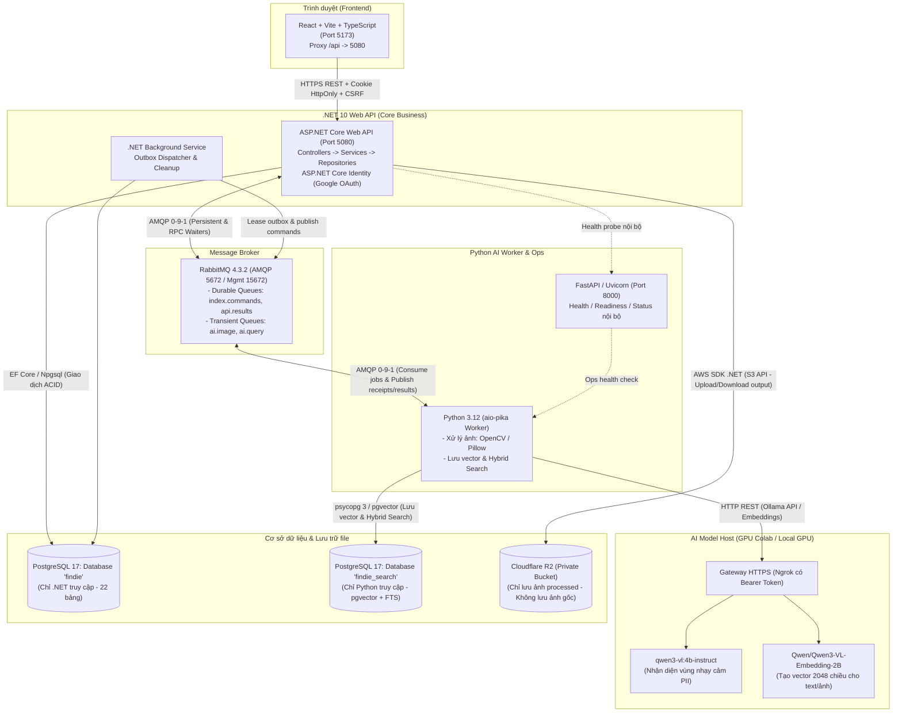
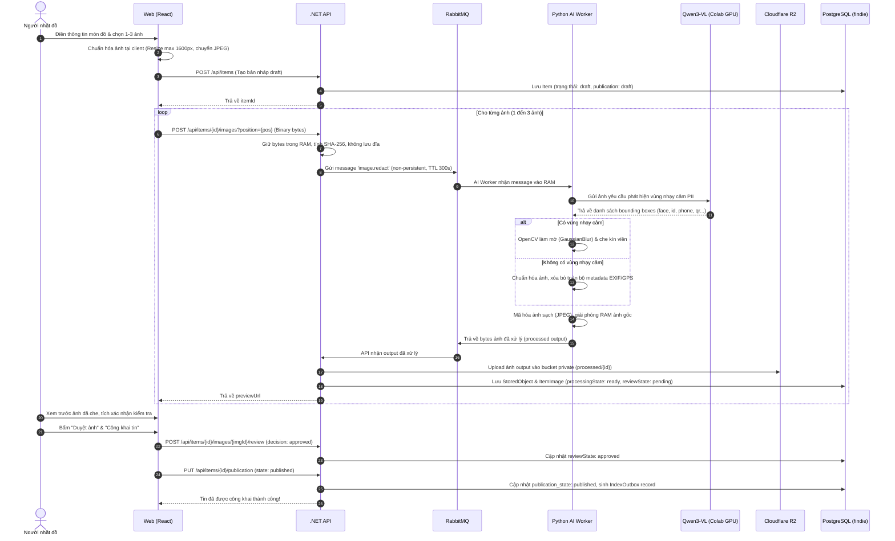
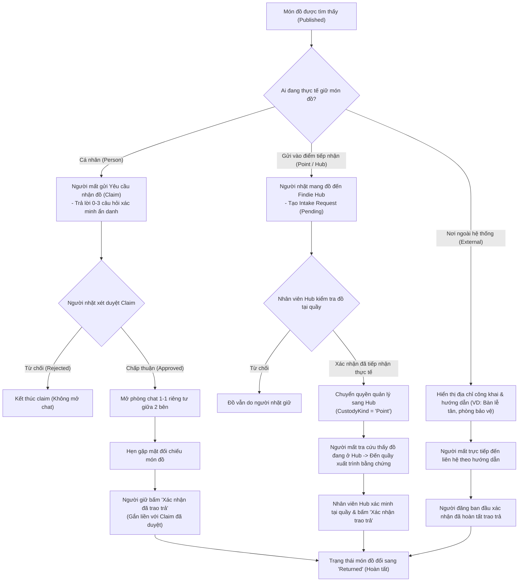

# BÁO CÁO TỔNG QUAN DỰ ÁN FINDIE (ONBOARDING GUIDE)

> **Dành cho:** Thành viên mới tham gia dự án Findie  
> **Phiên bản hệ thống:** v1.4.0 (MVP Runtime)  
> **Ngày cập nhật:** Tháng 11/2026  
> **Mục tiêu tài liệu:** Cung cấp bức tranh toàn cảnh về kiến trúc hệ thống, công nghệ, các luồng nghiệp vụ cốt lõi, cơ chế giao tiếp giữa các service và hướng dẫn khởi chạy dành cho developer mới.

---

## 1. TỔNG QUAN DỰ ÁN FINDIE

### 1.1. Bài toán & Mục tiêu sản phẩm
**Findie** là nền tảng số hỗ trợ tìm kiếm và trao trả đồ đạc thất lạc (Lost & Found) một cách an toàn, tin cậy và có ứng dụng trí tuệ nhân tạo (AI).

Những vấn đề thường gặp trong việc tìm đồ truyền thông (mạng xã hội, bảng tin):
- **Lộ lọt thông tin cá nhân (PII):** Ảnh chụp giấy tờ tuỳ thân (CCCD/CMND, thẻ sinh viên, bằng lái xe), số điện thoại, địa chỉ nhà đăng công khai dễ bị kẻ xấu lợi dụng lừa đảo, làm giả danh tính.
- **Khai man, nhận vơ đồ:** Người lạ giả làm chủ sở hữu để chiếm đoạt món đồ.
- **Khó tìm kiếm:** Tìm kiếm trên mạng xã hội dựa hoàn toàn vào từ khóa chính xác, dễ trôi bài, không hỗ trợ tìm bằng ảnh hoặc mô tả ngữ nghĩa mờ.
- **Bàn giao thiếu tin cậy:** Khó sắp xếp địa điểm gặp mặt trực tiếp an toàn giữa hai người lạ.

**Findie giải quyết các vấn đề trên thông qua:**
1. **Bảo vệ quyền riêng tư tuyệt đối (Zero Raw Image Storage):** AI tự động nhận diện và làm mờ/che kín các vùng nhạy cảm (khuôn mặt, số CCCD, số điện thoại, địa chỉ, mã QR/Barcode). **Ảnh gốc của người dùng không bao giờ được lưu trữ vào cơ sở dữ liệu hay Cloud Storage (R2)**.
2. **Tìm kiếm thông minh (Hybrid Search):** Hỗ trợ tìm kiếm bằng văn bản mô tả tiếng Việt tự nhiên (kết hợp vector ngữ nghĩa + từ khóa toàn văn) và tìm kiếm bằng hình ảnh (Native Multimodal Embedding).
3. **Cơ chế xác minh & trao trả đa dạng (3 nhánh nhận lại đồ):**
   - *Cá nhân giữ:* Trả lời câu hỏi bảo mật ẩn danh -> Người giữ xét duyệt -> Mở chat 1-1 -> Gặp mặt bàn giao.
   - *Điểm tiếp nhận (Findie Hub):* Người nhặt gửi đồ vào Hub -> Nhân viên Hub xác nhận tiếp nhận thực tế -> Người mất đến quầy Hub xác minh nhận lại.
   - *Nơi ngoài hệ thống:* Địa chỉ quầy công cộng (thư viện, văn phòng ban quản lý tòa nhà...).

---

## 2. KIẾN TRÚC TỔNG THỂ HỆ THỐNG (SYSTEM ARCHITECTURE)

Hệ thống Findie được thiết kế theo kiến trúc **Microservices / Event-Driven Modular** phân định trách nhiệm rõ ràng (Separation of Concerns).



### 2.1. Phân chia trách nhiệm giữa các thành phần

| Thành phần | Công nghệ / Nơi chạy | Trách nhiệm chính | Ranh giới bảo mật |
| :--- | :--- | :--- | :--- |
| **Web Frontend** | React, TypeScript, Vite, Tailwind CSS (Máy local, Port 5173) | Giao diện người dùng, điều hướng, biểu mẫu, nén/chuẩn hóa kích thước ảnh ở client trước khi gửi. | Không lưu token trong LocalStorage (dùng Cookie HttpOnly); không chứa bất kỳ secret key nào. |
| **Business API** | C#, .NET 10, ASP.NET Core Web API (Port 5080) | Toàn bộ nghiệp vụ chính: phân quyền, bài đăng, yêu cầu claim, hội thoại chat, tiếp nhận tại Hub, bàn giao, outbox dispatch. Quản lý lưu trữ R2. | Nguồn chuẩn duy nhất của dữ liệu nghiệp vụ. Không nhúng model AI hay xử lý pixel trực tiếp. |
| **AI Worker & Ops** | Python 3.12, aio-pika, OpenCV, FastAPI (Port 8000) | Nhận job qua RabbitMQ: giải mã ảnh trong RAM, gọi model nhận diện PII, chạy OpenCV che mờ, tạo vector embedding, lưu vào vector database và thực thi Hybrid Search. | Không có quyền truy cập DB `findie`, không có credential R2, không mở API công khai cho client. |
| **Message Broker** | RabbitMQ 4.3.2 (AMQP Port 5672, Mgmt 15672) | Điều phối bất đồng bộ giữa .NET và Python: hàng đợi bền vững cho lệnh index/outbox; hàng đợi tạm độc quyền (exclusive/transient) cho ảnh thô và truy vấn. | Chỉ chạy nội bộ; có phân quyền người dùng riêng biệt giữa API (.NET) và Worker (Python). |
| **Database Nghiệp vụ** | PostgreSQL 17 (Database `findie`) | Lưu 22 bảng nghiệp vụ: người dùng (ASP.NET Identity), món đồ, ảnh đã xử lý, yêu cầu, tin nhắn, sự kiện custody, outbox... | Chỉ .NET sở hữu user và password truy cập. |
| **Database Tìm kiếm** | PostgreSQL 17 + extension `pgvector` (Database `findie_search`) | Lưu bảng `ai_items` (watermark, tombstone) và `ai_documents` (vector 2048 chiều, tsvector full-text search, metadata lọc). | Chỉ Python sở hữu user và password truy cập. |
| **File Storage** | Cloudflare R2 (Private S3 Bucket) | Lưu trữ vĩnh viễn các ảnh đầu ra đã che (processed output). | Bucket private, không bật public URL; chỉ .NET truy cập qua S3 API để lấy/tải/xóa ảnh. |
| **Model Hosting** | Google Colab GPU / Server GPU qua Ngrok Gateway | Chạy 2 mô hình: `Qwen/Qwen3-VL-Embedding-2B` (tạo vector văn bản/ảnh) và `qwen3-vl:4b-instruct` (nhận diện vùng nhạy cảm). | Bảo vệ bởi `FINDIE_OLLAMA_TOKEN` (Bearer token tối thiểu 32 ký tự). |

---

## 3. CÁCH CÁC SERVICE GIAO TIẾP VỚI NHAU (INTER-SERVICE COMMUNICATION)

### 3.1. Web Frontend ↔ .NET Backend API
- **Giao thức:** HTTPS RESTful API. Trong môi trường dev, Vite cấu hình proxy chuyển tiếp toàn bộ request `/api` sang `http://127.0.0.1:5080`.
- **Xác thực phiên (Authentication):**
  - Đăng nhập duy nhất qua **Google OAuth 2.0**.
  - Sau khi callback thành công, server cấp **Cookie phiên `HttpOnly`, `SameSite=Lax`** (Secure khi ở Production). Không dùng JWT lưu ở client.
- **Bảo vệ chống giả mạo (CSRF Protection):**
  - Mọi thao tác ghi dữ liệu (POST, PUT, DELETE) bắt buộc gọi `GET /api/auth/csrf` để lấy anti-forgery token và gửi kèm trong header `X-CSRF-TOKEN`.
- **Đảm bảo tính duy nhất (Idempotency):**
  - Các thao tác tạo mới/cập nhật quan trọng (đăng bài, xét duyệt, bàn giao, upload ảnh) yêu cầu header `Idempotency-Key: <UUID>` để chống duplicate submit do mạng lag hoặc retry.

### 3.2. .NET Backend API ↔ RabbitMQ ↔ Python AI Worker
Hai service .NET và Python không gọi trực tiếp HTTP lẫn nhau khi xử lý nghiệp vụ AI, mà giao tiếp bất đồng bộ qua **RabbitMQ bằng kết nối AMQP 0-9-1 lâu dài (Long-lived connections)**.

#### Cơ chế quản lý kết nối & Queue:
1. **Exchange & Queue bền vững (Durable Quorum Queues):**
   - `findie.ai.commands`: .NET đẩy các lệnh lập chỉ mục (`index.upsert`, `index.source.image`, `index.remove`).
   - `findie.api.results`: Python trả biên nhận (`receipt`) xác nhận đã commit chỉ mục thành công vào `findie_search`.
2. **Queue tạm độc quyền (Exclusive / Auto-Delete Transient Queues):**
   - Được Python khai báo theo vòng đời worker, dùng để nhận dữ liệu nhạy cảm hoặc truy vấn tạm thời:
     - `findie.ai.image`: Xử lý che ảnh (`image.redact`) và tìm kiếm bằng ảnh (`search.hybrid.image`). Message có cờ `non-persistent` và `TTL` (300 giây cho redact, 30 giây cho tìm kiếm).
     - `findie.ai.query`: Nhận truy vấn tìm kiếm văn bản (`search.hybrid`).
   - Queue phản hồi tạm của .NET: Broker tự sinh tên ngẫu nhiên, gắn với từng request HTTP đang chờ kết quả (RPC style qua CorrelationId).

#### Envelope & Định dạng Message AMQP:
- `BasicProperties`: Chứa `Type` (tên operation), `CorrelationId` (UUID theo dõi request), `ReplyTo` (queue nhận kết quả), `Expiration` (TTL tính bằng mili-giây).
- Header `metadata`: Chuỗi JSON UTF-8 nhỏ (tối đa 16 KiB) mô tả chi tiết: `schemaVersion`, `jobId`, `leaseToken`, `modelId`, `modelRevision`, `deadlineAt`...
- Body:
  - Nếu là văn bản/lệnh: JSON UTF-8 compact.
  - Nếu là ảnh: **Dữ liệu nhị phân nguyên bản (Binary bytes)** tối đa 10 MiB, không base64 nhằm tối ưu hiệu năng RAM và mạng.

### 3.3. Python AI Worker ↔ Vector Search Database (`findie_search`)
- Worker Python kết nối trực tiếp đến database `findie_search` trên PostgreSQL qua thư viện `psycopg 3` và `pgvector`.
- Khi nhận lệnh `index.upsert`:
  1. Python tính toán vector embedding 2048 chiều bằng model `Qwen3-VL-Embedding-2B`.
  2. Chuẩn hóa L2 vector.
  3. Mở transaction SQL ghi nhận `document_version`, `snapshot_sha256`, tạo chỉ mục từ khóa toàn văn (`tsvector` kết hợp hàm `unaccent`) và lưu vector vào cột `embedding vector(2048)`.
  4. Sau khi commit thành công vào DB, Python mới gửi biên nhận (receipt) về RabbitMQ và ACK message gốc.

### 3.4. Python AI Worker ↔ Colab / GPU Model Gateway
- Worker gọi gateway thông qua endpoint tương thích chuẩn **Ollama API** hoặc **Transformers inference wrapper**:
  - `POST /api/embeddings`: Gửi text hoặc ảnh đã mã hóa để nhận về vector đặc trưng (2048 chiều).
  - `POST /api/chat`: Gửi ảnh và prompt hệ thống cho `qwen3-vl:4b-instruct` yêu cầu trả về toạ độ bounding box JSON các vùng PII nhạy cảm:
    ```json
    {"sensitive_regions": [{"label": "identity_number", "bbox": [y1, x1, y2, x2]}]}
    ```
- Toàn bộ kết nối được bảo vệ bởi Bearer token (`FINDIE_OLLAMA_TOKEN`).

### 3.5. .NET Backend API ↔ Cloudflare R2
- Sử dụng thư viện AWS SDK for .NET (tương thích S3 API của Cloudflare R2).
- **Quy tắc bất biến:**
  - Bucket R2 là **Private**, không có custom domain hay link public.
  - **Không bao giờ tải ảnh gốc lên R2.**
  - Chỉ khi Python AI trả về byte ảnh đã che/chuẩn hóa (processed output) hợp lệ kèm checksum SHA-256, .NET mới cấp phát Object ID ngẫu nhiên tại thư mục `processed/{id}` và upload lên R2.
  - Client muốn xem ảnh phải gọi qua endpoint của .NET: `GET /api/items/{itemId}/images/{imageId}/content`. Backend sẽ kiểm tra quyền truy cập của người xem trước khi stream ảnh từ R2 về client.

---

## 4. CÁC LUỒNG HOẠT ĐỘNG CHÍNH (CORE WORKFLOWS)

### 4.1. Luồng 1: Đăng tin nhặt được & Xử lý che ảnh riêng tư (Redaction Pipeline)



### 4.2. Luồng 2: Lập chỉ mục tìm kiếm bền vững (Transactional Outbox Pattern)
Để đảm bảo dữ liệu tìm kiếm luôn đồng bộ với dữ liệu nghiệp vụ mà không bị mất mát khi gặp sự cố mạng:
1. Khi có sự kiện thay đổi dữ liệu tìm kiếm (tin được công khai, sửa mô tả, duyệt ảnh, ẩn tin, xóa tin), .NET ghi một bản ghi vào bảng `index_outbox` **trong cùng Transaction Database với thay đổi của món đồ**.
2. Một Background Service trong .NET (`RecoveryMaintenance`) định kỳ quét bảng `index_outbox`, dùng cú pháp `SELECT ... FOR UPDATE SKIP LOCKED` để khóa tác vụ và gán lease (90 giây).
3. Service đẩy lệnh `index.upsert` (kèm snapshot thông tin) và `index.source.image` (kèm bytes ảnh đã duyệt) vào hàng đợi `findie.ai.commands` của RabbitMQ.
4. Python AI Worker nhận lệnh, tính vector embedding, lưu vào DB `findie_search`, rồi gửi `receipt` xác nhận về queue `findie.api.results`.
5. .NET nhận biên nhận, cập nhật trạng thái outbox thành công và ACK message. Nếu có lỗi, cơ chế exponential backoff sẽ thử lại an toàn.

### 4.3. Luồng 3: Tìm kiếm thông minh (Hybrid Search Workflow)
Hệ thống cung cấp 3 cách tìm kiếm:
1. **Tìm bằng mô tả tiếng Việt (`POST /api/search`):** Kết hợp cả 2 nhánh:
   - *Nhánh ngữ nghĩa (Dense Semantic):* Tạo vector truy vấn bằng `Qwen3-VL-Embedding-2B` -> Tính khoảng cách cosine `<=>` trên pgvector.
   - *Nhánh từ khóa (Lexical Keyword):* PostgreSQL Full-Text Search qua `tsvector`, lọc không dấu (`unaccent`), xếp hạng theo độ bao phủ từ khóa `ts_rank_cd`.
   - *Hợp nhất thứ hạng (Rank Fusion):* Dùng thuật toán **Weighted Reciprocal Rank Fusion (RRF)** để tính điểm tổng hợp:
     $$\text{Score}(d) = \frac{w_{\text{dense}}}{60 + \text{Rank}_{\text{dense}}} + \frac{w_{\text{keyword}}}{60 + \text{Rank}_{\text{keyword}}}$$
2. **Tìm bằng hình ảnh (`POST /api/search/image`):** Gửi 1 ảnh -> AI tạo vector ảnh native -> Tìm các món có vector ảnh tương đồng nhất trên pgvector.
3. **Tìm kết hợp đa phương thức (`POST /api/search/images`):** Gửi tối đa 3 ảnh + 1 đoạn mô tả -> Hệ thống thực hiện song song các nhánh tìm kiếm và hợp nhất điểm bằng RRF.

> **Đặc biệt:** Python chỉ trả về danh sách mã định danh ứng viên (`itemId`, `rank`). .NET Backend nhận kết quả, sau đó truy vấn DB nghiệp vụ để kiểm tra lại quyền hiển thị, trạng thái tin (chưa bị xóa, chưa trao trả), áp dụng bộ lọc ngày/khu vực trước khi trả DTO về cho người dùng.

### 4.4. Luồng 4: Ba nhánh nhận lại đồ & Trao trả thực tế



---

## 5. THIẾT KẾ CƠ SỞ DỮ LIỆU (DATABASE SCHEMA)

Hệ thống tách biệt hoàn toàn 2 cơ sở dữ liệu vật lý/logic:

### 5.1. Database Nghiệp vụ: `findie` (Do .NET quản lý)
Bao gồm 22 bảng, trong đó có 7 bảng Identity và 15 bảng nghiệp vụ chính:

| Bảng | Mục đích |
| :--- | :--- |
| `app_users` | Tài khoản người dùng (mã Guid, liên kết Google OAuth, tên hiển thị, trạng thái khóa). |
| `reception_points` | Danh sách Điểm tiếp nhận Findie Hub (Tên, địa chỉ công khai, tọa độ, trạng thái hoạt động). |
| `point_staff` | Phân quyền nhân viên tại Hub (`can_receive`, `can_return`). |
| `items` | Bảng cốt lõi chứa thông tin món đồ: tiêu đề, mô tả công khai, khu vực, thời gian nhặt, nơi đang giữ (`person`, `point`, `external`), trạng thái vòng đời (`active`, `returned`, `deleted`), trạng thái xuất bản (`draft`, `published`, `hidden`), các trường concurrency version (`row_version`, `document_version`). |
| `stored_objects` | Quản lý metadata của file đã lưu trên Cloudflare R2 (key, sha256, byte_size, mime_type, trạng thái lifecycle). |
| `item_images` | Ảnh gắn với món đồ (tối đa 3 ảnh/tin, vị trí 1-3, trạng thái xử lý AI, trạng thái duyệt của người dùng). |
| `verification_questions` | Tối đa 3 câu hỏi xác minh ẩn danh do người nhặt thiết lập cho món đồ. |
| `claims` | Yêu cầu nhận đồ của người mất (`pending`, `approved`, `rejected`), liên kết với món đồ và phiên lưu giữ. |
| `claim_answers` | Câu trả lời cho các câu hỏi xác minh từ người gửi claim (dữ liệu bảo mật riêng tư). |
| `conversations` | Phòng chat 1-1, chỉ được sinh ra khi một Claim chuyển sang `approved`. |
| `messages` | Tin nhắn văn bản trong phòng chat (có số thứ tự `sequence` để chống lặp và phục vụ đọc bù). |
| `intake_requests` | Yêu cầu gửi đồ nhặt được vào Findie Hub (`pending`, `received`, `rejected`). |
| `custody_events` | Nhật ký bất biến ghi lại toàn bộ lịch sử luân chuyển món đồ và thời điểm trao trả hoàn tất. |
| `index_outbox` | Hàng đợi Transactional Outbox dùng đồng bộ trạng thái sang AI Search Service. |
| `idempotency_keys` | Lưu vết các thao tác ghi dữ liệu kèm khóa Idempotency của client để chống gửi trùng lặp. |
| `ai_jobs` | Quản lý trạng thái xử lý các job AI nền dài hạn. |

### 5.2. Database Tìm kiếm: `findie_search` (Do Python quản lý)
Chỉ lưu trữ các dữ liệu công khai đã được duyệt và vector embedding:
- `ai_items`: Lưu `item_id`, `document_version`, `snapshot_sha256` và cờ `tombstone` (để nhận biết tin đã bị xóa/ẩn và ngăn chặn các message cũ ghi đè).
- `ai_documents`: Lưu chi tiết các nguồn đã vector hóa (văn bản hoặc ảnh đã duyệt):
  - Model info: `model_id`, `model_revision`, `dimensions` (2048), `processing_profile`.
  - Bộ lọc: `found_area`, `found_on`, `found_from`, `found_until`, `location_tokens`.
  - Tìm kiếm toàn văn: `search_terms tsvector` (đã chuẩn hóa không dấu).
  - Vector: `embedding vector(2048)` hỗ trợ tìm kiếm chính xác qua pgvector.

---

## 6. NGUYÊN TẮC BẢO MẬT & HIẾN CHƯƠNG DỰ ÁN (CORE PRINCIPLES)

Dự án tuân thủ nghiêm ngặt các nguyên tắc được định nghĩa trong Hiến chương dự án (`.specify/memory/constitution.md`):

1. **Nguyên tắc "Không lưu ảnh gốc" (Zero Raw Image Retention):**
   - Ảnh gốc do người dùng tải lên chỉ được tồn tại tạm thời trong bộ nhớ RAM của .NET và Python trong vòng đời của request xử lý.
   - Tuyệt đối không ghi ảnh gốc ra đĩa cứng, database, log, hàng đợi bền vững hay Cloudflare R2.
   - Nếu quá trình xử lý gặp lỗi, timeout hoặc crash, buffer RAM bị hủy và client phải tải lại ảnh.
2. **Nguyên tắc "Bảo vệ dữ liệu riêng tư mặc định" (Private by Default):**
   - Ảnh sau khi AI che mờ vẫn ở trạng thái chờ duyệt (`needs_review`). Chỉ khi người quản lý tin xem lại và bấm "Duyệt ảnh" thì ảnh mới được công khai và tạo vector tìm kiếm.
   - Câu trả lời xác minh, nội dung chat, địa chỉ nhà riêng không bao giờ được đưa vào vector tìm kiếm công khai.
3. **Nguyên tắc "Xác minh thực tế trước khi hoàn tất" (Physical Verification):**
   - Việc duyệt claim hoặc mở chat không đồng nghĩa với việc đã trao trả đồ.
   - Trạng thái `returned` chỉ được kích hoạt khi có xác nhận bàn giao thực tế tại chỗ.
4. **Phân quyền chặt chẽ (Zero-Trust Backend):**
   - Mọi quyền hạn (người giữ hiện tại, người đăng, nhân viên Hub) được kiểm tra tại server trên từng request; không tin tưởng vai trò hay dữ liệu do frontend gửi lên.

---

## 7. HƯỚNG DẪN KHỞI CHẠY DÀNH CHO DEVELOPER MỚI (DEVELOPER QUICKSTART)

### 7.1. Yêu cầu công cụ
Đảm bảo máy của bạn đã cài đặt các công cụ sau:
- **Docker & Docker Compose** (Docker Desktop đang chạy). Trên Windows, khuyến nghị sử dụng **WSL2** (Ubuntu).
- **Node.js 24.x** và npm (khuyên dùng `nvm use`).
- **.NET 10 SDK** (tối thiểu phiên bản `10.0.100`).
- **Python 3.12** cùng công cụ quản lý gói **`uv`**.
- Lệnh **`make`** và **`curl`**.

### 7.2. Các bước thiết lập ban đầu (Step-by-Step)

#### Bước 1: Khởi tạo biến môi trường
Tại thư mục gốc dự án, chạy lệnh:
```sh
make env
```
Lệnh này sẽ tự động tạo file `.env`, sinh ngẫu nhiên mật khẩu database, token RabbitMQ và token nội bộ `AI_SERVICE_TOKEN`.

#### Bước 2: Cấu hình Google OAuth & Cloudflare R2
Mở file `.env` vừa sinh và điền thông tin:
1. **Google OAuth Client ID & Secret:**
   - Đăng ký Redirect URI trên Google Cloud Console: `http://127.0.0.1:5173/api/auth/google/signin`
   - Cập nhật biến:
     ```dotenv
     Authentication__Google__ClientId='YOUR_CLIENT_ID.apps.googleusercontent.com'
     Authentication__Google__ClientSecret='YOUR_CLIENT_SECRET'
     ```
2. **Cloudflare R2 Bucket (Private):**
   - Cập nhật thông tin S3 Credentials của R2:
     ```dotenv
     Storage__Endpoint='https://<ACCOUNT_ID>.r2.cloudflarestorage.com'
     Storage__Bucket='findie-local'
     Storage__AccessKeyId='<R2_ACCESS_KEY>'
     Storage__SecretAccessKey='<R2_SECRET_KEY>'
     ```

#### Bước 3: Cài đặt phụ thuộc & Khởi tạo hạ tầng
Chạy lệnh tự động hóa:
```sh
make local-setup
```
Lệnh này sẽ:
- Khởi động 2 container Docker: PostgreSQL (kèm pgvector) và RabbitMQ.
- Thực thi EF Core Migrations cho DB nghiệp vụ `findie`.
- Khởi tạo schema cho DB tìm kiếm `findie_search`.
- Cài đặt toàn bộ packages: .NET NuGet, Python uv packages và npm frontend.
- Tạo điểm tiếp nhận mặc định: **Findie Demo Hub**.

#### Bước 4: Chạy Model AI trên Google Colab
Mở Google Colab và tải lên file notebook:  
`notebooks/colab/04_full_stack_ollama_ngrok.ipynb`
1. Đổi Runtime sang **GPU** (miễn phí T4).
2. Nhập 2 secret: `NGROK_AUTHTOKEN` và `FINDIE_OLLAMA_TOKEN` (tự chọn token dài ≥ 32 ký tự).
3. Chạy toàn bộ cell để nạp model `Qwen3-VL-Embedding-2B` và `qwen3-vl:4b-instruct`.
4. Chạy cell cuối cùng để tải file `findie-colab.json` về máy của bạn.

#### Bước 5: Nhập cấu hình Model về máy local
Tại máy local, chạy:
```sh
python3 scripts/configure_ollama.py ~/Downloads/findie-colab.json
```
Nhập đúng `FINDIE_OLLAMA_TOKEN` đã dùng ở Colab. Script sẽ cập nhật URL Ngrok và fingerprint của model vào file `.env`.

#### Bước 6: Khởi chạy toàn bộ hệ thống
Chạy lệnh duy nhất để bật toàn bộ các service:
```sh
make local-run
```
Lệnh sẽ lần lượt khởi chạy:
1. **Python AI Worker + FastAPI** tại `http://127.0.0.1:8000`
2. **.NET Backend API** tại `http://127.0.0.1:5080`
3. **Web Vite Frontend** tại `http://127.0.0.1:5173`

Mở trình duyệt tại: **`http://127.0.0.1:5173`**.

#### Bước 7: Cấp quyền nhân viên Hub & Kiểm tra sức khỏe hệ thống
1. Đăng nhập vào web bằng tài khoản Google của bạn tại trang Sign In.
2. Mở một terminal mới và chạy lệnh cấp quyền nhân viên Findie Hub cho email vừa đăng nhập:
   ```sh
   make local-seed STAFF_EMAIL='your-email@gmail.com'
   ```
3. Chạy công cụ chẩn đoán sức khỏe hệ thống:
   ```sh
   make local-doctor
   ```
   Đảm bảo tất cả các mục kiểm tra đều hiển thị **PASS**.

---

## 8. DANH MỤC LỆNH TIỆN ÍCH (CHEAT SHEET)

| Lệnh | Ý nghĩa & Mục đích sử dụng |
| :--- | :--- |
| `make local-run` | Khởi chạy trọn vẹn toàn bộ các service (AI worker, API, Web). |
| `make local-stop` | Dừng các container Docker nhưng giữ nguyên volume dữ liệu. |
| `make local-doctor` | Kiểm tra toàn bộ kết nối, schema DB, queue RabbitMQ, quyền nhân viên và AI readiness. |
| `make local-reindex` | Đồng bộ và lập lại chỉ mục vector cho toàn bộ tin đăng trong DB. |
| `make check` | Chạy bộ kiểm tra tĩnh, build và unit tests cho cả API, Web và Python. |
| `make api-integration` | Chạy test tích hợp backend .NET với database và broker tạm thời. |
| `make ai-integration` | Chạy test tích hợp AI Worker với database tìm kiếm giả lập. |
| `docker compose logs -f db rabbitmq` | Xem log của database PostgreSQL và broker RabbitMQ. |

---

## 9. ĐẦU MỐI TÀI LIỆU CHI TIẾT TRONG REPOSITORY

Khi cần đào sâu vào từng module cụ thể, hãy tham khảo các tài liệu sau:
- [Đặc tả sản phẩm (Product Spec)](../docs/product/DAC_TA_FINDIE.md): Nghiệp vụ chi tiết, quy tắc BR01–BR06 và tiêu chí nghiệm thu.
- [Thiết kế kiến trúc hệ thống](../docs/architecture/system-architecture.md): Phân tích chi tiết thiết kế kỹ thuật v1.4.0.
- [Đặc tả API nghiệp vụ & Trao trả](../docs/api/recovery.md): Danh sách các endpoint HTTP, mã lỗi, payload mẫu cho Claim, Chat, Hub Intake.
- [Đặc tả API Ảnh & Tìm kiếm](../docs/api/media-search.md): Quy chuẩn upload ảnh nhị phân, bộ lọc tìm kiếm và Hybrid Search.
- [Hợp đồng AMQP RabbitMQ](../docs/api/amqp.md): Cấu trúc queue, exchange, routing key, schema envelope JSON/Binary.
- [Hướng dẫn AI Service](../docs/guides/ai-service.md): Chi tiết thuật toán Reciprocal Rank Fusion, prompt nhận diện PII và benchmark.
