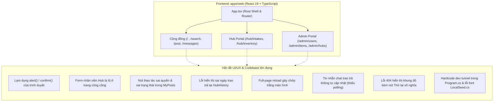
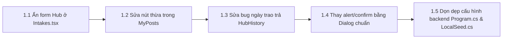
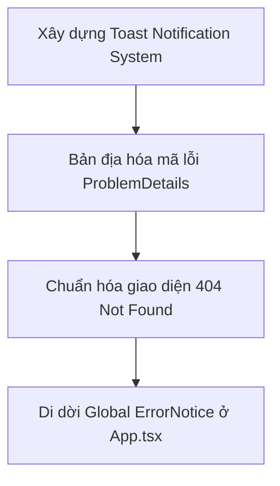
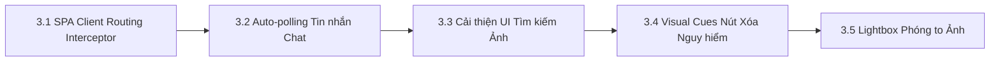

# Kế hoạch Chi tiết Tối ưu hóa UI/UX & Tinh gọn Mã nguồn Findie

> [!IMPORTANT]
> **Mục tiêu cốt lõi**: Nâng tầm trải nghiệm người dùng (UX) của Findie đạt chuẩn sản phẩm thực tế, đảm bảo an tâm, riêng tư và thân thiện; loại bỏ hoàn toàn các đoạn mã thừa/test tạm thời của môi trường lập trình; chuẩn hóa việc hiển thị lỗi và tăng tốc độ tương tác trên toàn hệ thống.

---

## 1. Tổng quan Kiến trúc & Phạm vi Đánh giá

Hệ thống Findie bao gồm 3 phân hệ chính tương ứng với các nhóm người dùng:
1. **Phân hệ Người dùng cộng đồng (Seeker & Finder)**: Tìm kiếm món đồ thất lạc (văn bản & hình ảnh AI), đăng tin nhặt được đồ, duyệt ảnh che mờ PII, gửi yêu cầu nhận đồ và trò chuyện hẹn trao trả.
2. **Phân hệ Findie Hub Workspace (`/hub`)**: Dành riêng cho nhân viên trực trạm tiếp nhận hiện vật từ người dân, quản lý kho lưu giữ và thực hiện thủ tục trao trả tận tay.
3. **Phân hệ Quản trị viên Super Admin (`/admin`)**: Giám sát hệ thống, khóa/mở tài khoản, kiểm duyệt tin đăng, thu hồi ảnh vi phạm PII và cấu hình mạng lưới trạm Hub.



---

## 2. Kế hoạch Thực thi Chi tiết (Work Breakdown Structure)

Kế hoạch được chia thành 3 giai đoạn rõ ràng theo mức độ ưu tiên từ khẩn cấp đến nâng cao.

### Giai đoạn 1: Khắc phục Lỗi Nghiệp vụ & Dọn dẹp Dev/Test Artifacts (Ưu tiên Cao)

Giai đoạn này tập trung xử lý các lỗi logic hiển thị, bảo mật giao diện và loại bỏ hoàn toàn các thành phần rác/test của developer.



#### Task 1.1: Ẩn form tiếp nhận của nhân viên Hub tại trang công cộng
* **Tệp liên quan**: `apps/web/src/pages/Intakes.tsx` (dòng 161–166)
* **Vấn đề**: Người dùng thường xem đề nghị tiếp nhận của mình (`own = true`) nhìn thấy accordion `<details><summary>Dành cho nhân viên điểm tiếp nhận</summary>{decisionForm}</details>`, chứa form tiếp nhận/từ chối của nhân viên Hub.
* **Giải pháp**:
  * Kiểm tra chặt chẽ: Chỉ render `decisionForm` khi người dùng hiện tại có quyền nhân viên trực trạm (`user.isStaff` hoặc `user.isAdmin`) VÀ là nhân viên phụ trách chính điểm trạm đó (`user.managedPoints.some(p => p.id === data.targetPointId)`).
  * Đối với người dùng thường sở hữu bài đăng (`own = true`): Chỉ hiển thị thông điệp trạng thái đang chờ tiếp nhận và hướng dẫn mang đồ tới quầy.

#### Task 1.2: Sửa nút thao tác sai quyền & sai trạng thái trong "Bài đăng của tôi"
* **Tệp liên quan**: `apps/web/src/pages/Recovery.tsx` (dòng 587–594)
* **Vấn đề**:
  * Đồ đã ở Hub (`item.custody.kind === "point"`) vẫn hiện link `"Xác nhận trao trả"` (dẫn tới 403 Forbidden vì người dùng không có quyền này).
  * Đồ đã ở Hub vẫn hiện link `"Chuyển vào Hub"`.
* **Giải pháp**:
  * Chỉ hiển thị nút `"Gửi vào Hub"` (`/items/${id}/transfer`) khi `item.custody.kind === "person"` và `item.lifecycle === "active"`.
  * Ẩn hoàn toàn nút `"Xác nhận trao trả"` đối với người dùng thường khi đồ đã lưu tại Hub. Nút này chỉ hiển thị khi `item.custody.kind === "external"` hoặc trong không gian quản lý của nhân viên trạm (`scope === "managed"`).

#### Task 1.3: Khắc phục lỗi hiển thị sai ngày trao trả hiện vật tại Nhật ký lưu chuyển Hub
* **Tệp liên quan**: `apps/web/src/pages/hub/HubHistory.tsx` (dòng 111)
* **Vấn đề**: Khi gộp các món đồ đã trao trả, mã nguồn đang gán `occurredAt: item.createdAt`. Món đồ tạo từ 1 tháng trước nhưng mới trao trả hôm nay lại bị hiển thị thời điểm trao trả là từ 1 tháng trước.
* **Giải pháp**: 
  * Sử dụng thuộc tính ngày cập nhật trạng thái mới nhất hoặc gọi API lịch sử lưu chuyển (`/custody-events`) để lấy chính xác mốc thời gian diễn ra sự kiện `returned`.

#### Task 1.4: Thay thế triệt để `alert()` và `window.confirm()` bằng Dialog UI tùy biến
* **Tệp liên quan**:
  * `apps/web/src/pages/admin/AdminHubs.tsx` (dòng 59, 73, 174, 194)
  * `apps/web/src/pages/admin/AdminItems.tsx` (dòng 51, 67, 74, 96)
  * `apps/web/src/pages/admin/AdminUsers.tsx` (dòng 35, 48)
  * `apps/web/src/pages/hub/HubHistory.tsx` (dòng 40)
  * `apps/web/src/pages/hub/HubIntakes.tsx` (dòng 49)
  * `apps/web/src/pages/Posting.tsx` (dòng 827)
* **Giải pháp**:
  * Tái sử dụng component modal chuẩn `ConfirmDialog` (hoặc xây dựng State Dialog nội bộ có backdrop, tiêu đề, mô tả và nút xác nhận có màu sắc cảnh báo rõ ràng).
  * Khi thao tác thất bại, ghi nhận lỗi vào state và hiển thị banner lỗi nội tuyến (inline `ErrorNotice`) hoặc Toast thông báo thay vì gọi hàm `alert()`.

#### Task 1.5: Dọn dẹp cấu hình backend và tệp dữ liệu mẫu
* **Tệp liên quan**:
  * `apps/api/Program.cs` (dòng 197): Loại bỏ host dev tunnel cứng `zfjnvx2f-5173.asse.devtunnels.ms`, chuyển sang đọc từ cấu hình môi trường hoặc cấu hình proxy linh hoạt.
  * `apps/api/Infrastructure/LocalSeed.cs` (dòng 14–20): Lưu lại tệp với định dạng UTF-8 chuẩn không BOM, sửa lại toàn bộ tên trạm và địa chỉ bị lỗi mã hóa mojibake (`"Findie Hub Mẫu ở Thủ Đức"`, `"Quầy tiếp nhận..."`).

---

### Giai đoạn 2: Chuẩn hóa Xử lý Lỗi & Nâng cấp Phản hồi Giao diện (Feedback System)

Giai đoạn này đảm bảo mọi phản hồi từ hệ thống (thành công, cảnh báo, lỗi) đều trực quan, thân thiện và không gây hoang mang cho người dùng.



#### Task 2.1: Xây dựng Hệ thống Toast Notification (Thông báo nổi tự tắt)
* **Vấn đề**: Dự án thiếu hệ thống thông báo nhanh khi hoàn thành các tác vụ phụ (Lưu hồ sơ, Đổi trạng thái tin, Thu hồi ảnh, Sao chép liên kết...). Giao diện hiện tại phải tải lại trang hoặc nhét alert làm vỡ layout.
* **Giải pháp**:
  * Bổ sung `ToastContext` và component `<ToastContainer />` vào `apps/web/src/components/ui.tsx`.
  * Hỗ trợ 4 trạng thái: `success`, `error`, `info`, `warning` với thời gian tự đóng (mặc định 3.5 giây), có nút tắt nhanh và hiệu ứng trượt mượt mà.

#### Task 2.2: Bản địa hóa thông điệp lỗi kỹ thuật ProblemDetails từ ASP.NET Core
* **Tệp liên quan**: `apps/web/src/lib/api.ts` (dòng 125–161)
* **Giải pháp**:
  * Nâng cấp hàm `extractProblemMessage`: Thiết lập bảng ánh xạ các thông điệp validation phổ biến của ASP.NET Core sang tiếng Việt:
    * `"The TargetPointId field is required."` $\rightarrow$ *"Vui lòng chọn điểm tiếp nhận Findie Hub."*
    * `"RowVersion mismatch"` / `"Concurrency conflict"` $\rightarrow$ *"Dữ liệu món đồ đã được cập nhật bởi thao tác khác. Vui lòng tải lại trang."*
    * `"The Title field is required."` $\rightarrow$ *"Vui lòng nhập tên món đồ."*
    * `"Invalid CSRF token."` $\rightarrow$ *"Phiên làm việc đã hết hạn. Hệ thống đang tự động làm mới..."* (đồng thời kích hoạt hàm làm mới token tự động).

#### Task 2.3: Chuẩn hóa trang lỗi 404 / Empty State thân thiện
* **Tệp liên quan**: `apps/web/src/pages/Explore.tsx` (dòng 541), `apps/web/src/pages/Custody.tsx`, `apps/web/src/pages/Intakes.tsx`
* **Giải pháp**:
  * Khi API trả về mã lỗi 404 (món đồ hoặc đề nghị không tồn tại/đã bị xóa), không hiển thị `ErrorNotice` màu đỏ kèm nút "Thử lại".
  * Thay thế bằng component `EmptyState` với icon minh họa nhẹ nhàng, tiêu đề: *"Không tìm thấy thông tin món đồ"* cùng nút điều hướng rõ ràng: `[Quay lại tìm kiếm]` hoặc `[Về trang chủ]`.

#### Task 2.4: Điều chỉnh vị trí `ErrorNotice` toàn cục trong `App.tsx`
* **Tệp liên quan**: `apps/web/src/App.tsx` (dòng 553)
* **Giải pháp**: Bỏ `<ErrorNotice error={action.error} />` nằm trơ trọi ở đầu thẻ `<main>`. Đưa phần hiển thị lỗi này vào trực tiếp bên trong menu tài khoản (Account Menu Dropdown) hoặc hiển thị qua Toast khi thao tác Đăng xuất thất bại.

---

### Giai đoạn 3: Tối ưu Trải nghiệm Điều hướng & Real-time (Interaction & Usability)

Giai đoạn này tập trung vào độ mượt mà của ứng dụng, loại bỏ hiện tượng giật màn hình và nâng cao trải nghiệm trò chuyện, tìm kiếm.



#### Task 3.1: Hiện thực Client-Side Navigation Interceptor trong `App.tsx`
* **Tệp liên quan**: `apps/web/src/App.tsx` (dòng 45–53)
* **Vấn đề**: Các thẻ `<a href="/...">` trên header, breadcrumb và các trang con đang kích hoạt tải lại toàn trang (full-page reload), gây chớp trắng màn hình và gọi lại API `loadUser` liên tục.
* **Giải pháp**:
  * Bổ sung cơ chế ủy quyền sự kiện (Global Click Delegation) cho toàn bộ liên kết nội bộ:
    ```ts
    document.addEventListener("click", (e) => {
      const target = (e.target as HTMLElement).closest("a");
      if (!target || target.target || target.hasAttribute("download")) return;
      const href = target.getAttribute("href");
      if (href && href.startsWith("/") && !href.startsWith("//")) {
        e.preventDefault();
        window.history.pushState(null, "", href);
        setPath(href.split("?")[0]);
      }
    });
    ```
  * Chuyển trang tức thì mà không cần nạp lại tài nguyên HTML/CSS/JS, giữ nguyên trạng thái phiên đăng nhập.

#### Task 3.2: Tự động cập nhật tin nhắn định kỳ (Auto-polling) trong Hội thoại Trao trả
* **Tệp liên quan**: `apps/web/src/pages/Recovery.tsx` (dòng 937–945)
* **Vấn đề**: Người dùng đang chat hẹn nhận đồ nhưng không nhận được tin nhắn mới trừ khi tự bấm icon "Làm mới".
* **Giải pháp**:
  * Thiết lập `setInterval` chạy mỗi 4 giây khi tab trình duyệt đang active (`!document.hidden`) và người dùng đang ở trong hội thoại có `chat.canSend === true`.
  * Tự động hủy interval khi chuyển sang trang khác để tiết kiệm băng thông.

#### Task 3.3: Tối ưu Trải nghiệm Tìm kiếm bằng Hình ảnh (Image Search UX)
* **Tệp liên quan**: `apps/web/src/pages/Explore.tsx` (dòng 265–294)
* **Giải pháp**:
  * Bổ sung nút **"Hủy tìm kiếm" (Cancel)** để người dùng có thể chủ động ngắt AbortController nếu mạng chậm hoặc muốn sửa lại từ khóa.
  * Hiển thị các bước xử lý trực quan: *"1/3: Đang tải ảnh..."* $\rightarrow$ *"2/3: AI đang phân tích đặc điểm..."* $\rightarrow$ *"3/3: Đối chiếu dữ liệu tin đăng..."*.

#### Task 3.4: Cải thiện tín hiệu thị giác cho nút hành động nguy hiểm (Destructive Action)
* **Tệp liên quan**: `apps/web/src/pages/Recovery.tsx` (dòng 688) & `apps/web/src/styles/styles.css`
* **Giải pháp**:
  * Định nghĩa class CSS `.button-danger` (nền đỏ `#dc2626`, chữ trắng, hover `#b91c1c`).
  * Áp dụng cho nút *"Xác nhận xóa bài đăng"* trong modal xóa và nút *"Khóa tài khoản"* trong quản trị người dùng.

#### Task 3.5: Bổ sung Lightbox xem ảnh kích thước lớn trong Chi tiết món đồ
* **Tệp liên quan**: `apps/web/src/pages/Explore.tsx` (dòng 573–589)
* **Giải pháp**: Cho phép người dùng nhấp vào ảnh để mở popup xem ảnh phóng to, hỗ trợ kiểm tra kỹ lưỡng các chi tiết đặc điểm của món đồ trước khi gửi yêu cầu nhận đồ.

---

## 3. Kế hoạch Kiểm thử & Đảm bảo Chất lượng (QA Plan)

### 3.1. Ma trận Kiểm thử Thủ công (Manual QA Matrix)

| Kịch bản kiểm thử | Đối tượng | Tiêu chí đạt (Acceptance Criteria) |
| :--- | :--- | :--- |
| **Gửi đề nghị vào Hub** | Người mất / nhặt | Người dùng thường xem đề nghị không thấy form tiếp nhận của nhân viên Hub. |
| **Quản lý bài đăng** | Finder | Đồ đã ở Hub không hiển thị nút "Chuyển vào Hub" hay "Xác nhận trao trả". |
| **Thao tác Admin** | Super Admin | Khóa tài khoản / tạm ẩn tin hiển thị Modal xác nhận đẹp mắt, không bật `window.confirm`/`alert`. |
| **Xử lý sự cố mạng / 404** | Toàn bộ | Truy cập URL đồ không tồn tại hiển thị EmptyState thân thiện, không báo lỗi đỏ kèm nút "Thử lại". |
| **Trò chuyện trao trả** | Seeker & Finder | Gửi tin nhắn từ cửa sổ A, cửa sổ B tự động nhận được tin nhắn sau tối đa 4 giây mà không cần bấm F5. |
| **Điều hướng ứng dụng** | Toàn bộ | Bấm chuyển đổi giữa các tab menu không làm chớp trắng trang hoặc tải lại trình duyệt. |

### 3.2. Kiểm tra Tính toàn vẹn Mã nguồn & Bảo mật
* Chạy kiểm tra đóng gói trong `apps/web` đảm bảo không có lỗi TypeScript hoặc lỗi đóng gói.
* Xác thực nghiêm ngặt: Không để lộ bí mật môi trường, tuân thủ nguyên tắc Findie không lưu trữ ảnh gốc ra nơi công cộng và không hiển thị thông tin PII nhạy cảm.

---

## 4. Lộ trình Triển khai (Timeline & Milestones)

| Mốc thời gian | Trọng tâm công việc | Kết quả đầu ra dự kiến |
| :---: | :--- | :--- |
| **Ngày 1 (Buổi sáng)** | Triển khai Giai đoạn 1 | Ẩn form Hub ở `Intakes.tsx`; sửa nút thừa trong `MyPosts`; thay toàn bộ `alert`/`confirm` bằng Dialog UI. |
| **Ngày 1 (Buổi chiều)** | Triển khai Giai đoạn 2 | Tích hợp Toast System; chuẩn hóa lỗi ProblemDetails tiếng Việt; sửa trang 404 thân thiện. |
| **Ngày 2 (Buổi sáng)** | Triển khai Giai đoạn 3 | Kích hoạt SPA Routing Interceptor; thêm auto-polling chat tin nhắn; hoàn thiện style nút danger. |
| **Ngày 2 (Buổi chiều)** | QA & Rà soát cuối cùng | Kiểm thử toàn diện trên trình duyệt Desktop & Mobile; chạy build kiểm tra lỗi typecheck. |
