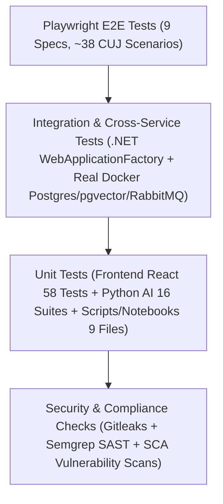

# BÁO CÁO TOÀN DIỆN VỀ HỆ THỐNG KIỂM THỬ (TESTING REPORT) - FINDIE

> **Dự án:** Findie - Nền tảng kết nối trao trả đồ thất lạc vì cộng đồng  
> **Cập nhật ngày:** 08/11/2026  
> **Tác giả:** Đội ngũ Kỹ thuật & QA Findie  
> **Trạng thái:** Toàn bộ test suite đã sẵn sàng, đồng bộ và hoạt động ổn định trên các nhánh phát triển.

---

## 1. TỔNG QUAN CHIẾN LƯỢC KIỂM THỬ (TESTING STRATEGY)

Findie áp dụng mô hình **Kim tự tháp kiểm thử (Test Pyramid)** kết hợp với nguyên lý **Phòng thủ đa lớp (Defense-in-Depth)** nhằm bảo đảm tính đúng đắn về nghiệp vụ, hiệu năng xử lý đa phương thức và tính tuân thủ nghiêm ngặt về **bảo vệ quyền riêng tư (Privacy & Redaction)**.



### Các lớp kiểm thử chính:
1. **Security & Compliance Scans:** Quét mã nguồn trước khi tích hợp để ngăn chặn rò rỉ secret, PII và thư viện có lỗ hổng bảo mật đã công bố.
2. **Unit Tests (Kiểm thử đơn vị):** Kiểm tra tính logic của các helper, parser thời gian, thuật toán xếp hạng, cơ chế che mờ ảnh PII, và xác thực hợp đồng dữ liệu.
3. **Integration & Cross-Service Tests:** Kiểm thử tích hợp thực sự giữa Backend .NET 9, RabbitMQ 4, PostgreSQL 17 (pgvector) và Python AI Service. Không dùng mock giả lập cơ sở dữ liệu để đảm bảo tính toàn vẹn của transaction, locking và concurrency token.
4. **End-to-End (E2E) Tests:** Sử dụng Playwright giả lập hành vi người dùng cuối (tìm kiếm ảnh, đăng tin, nhận đồ, duyệt tin, phân quyền quản trị, bàn giao tại Findie Hub).

---

## 2. DANH SÁCH CHI TIẾT CÁC BỘ TEST CASE

### 2.1. Frontend Web - Unit Tests (`apps/web/src/lib/*.test.ts`)
Bao gồm **58 unit tests** độc lập, chạy trên môi trường Node.js native (`--experimental-strip-types --test`), kiểm tra toàn bộ logic xử lý phía client:

| Tệp kiểm thử | Số test | Nội dung kiểm tra chính |
| :--- | :---: | :--- |
| [`adminApi.test.ts`](file:///d:/CNTT-SGU/HK7/Hackathon/FindieHackathon/apps/web/src/lib/adminApi.test.ts) | 7 | Gọi API thống kê, phân trang người dùng, gửi CSRF token khi đổi trạng thái khóa tài khoản, ẩn tin đăng, thu hồi quyền nhân viên trạm, chặn URL độc hại ngoài local route. |
| [`api.test.ts`](file:///d:/CNTT-SGU/HK7/Hackathon/FindieHackathon/apps/web/src/lib/api.test.ts) | 12 | Format ngày giờ chuẩn Việt Nam (UTC+7), kiểm tra CSRF token trong cookie, chuẩn hóa tham số query string, xử lý timeout và lỗi mạng. |
| [`auth.test.ts`](file:///d:/CNTT-SGU/HK7/Hackathon/FindieHackathon/apps/web/src/lib/auth.test.ts) | 8 | Quản lý phiên người dùng (`loadUser`), lưu trữ vai trò (`isAdmin`, `isStaff`), logic chuyển hướng đăng nhập và đăng xuất an toàn. |
| [`images.test.ts`](file:///d:/CNTT-SGU/HK7/Hackathon/FindieHackathon/apps/web/src/lib/images.test.ts) | 7 | Xác thực file ảnh hợp lệ (JPEG, PNG, WebP), giới hạn dung lượng 10MB/ảnh, số lượng ảnh tối đa (1–3 ảnh), chặn định dạng không an toàn (.exe, .pdf, .svg). |
| [`intakeDecision.test.ts`](file:///d:/CNTT-SGU/HK7/Hackathon/FindieHackathon/apps/web/src/lib/intakeDecision.test.ts) | 4 | Quy tắc duyệt/từ chối yêu cầu tiếp nhận đồ vào Findie Hub, kiểm tra ghi chú bắt buộc khi từ chối. |
| [`itemForm.test.ts`](file:///d:/CNTT-SGU/HK7/Hackathon/FindieHackathon/apps/web/src/lib/itemForm.test.ts) | 7 | Xây dựng draft tin đăng, xác thực 3 nhánh lưu giữ đồ (`person`, `point`, `external`), chặn thời gian nhặt trong tương lai, chuẩn hóa múi giờ Việt Nam. |
| [`pagination.test.ts`](file:///d:/CNTT-SGU/HK7/Hackathon/FindieHackathon/apps/web/src/lib/pagination.test.ts) | 3 | Thuật toán sinh danh sách trang hiển thị (danh sách ngắn, danh sách dài có dấu `...`, bảo đảm không lặp trang). |
| [`search.test.ts`](file:///d:/CNTT-SGU/HK7/Hackathon/FindieHackathon/apps/web/src/lib/search.test.ts) | 7 | Gửi request tìm kiếm đa phương thức (ảnh + mô tả + bộ lọc), xử lý fallback khi AI 503, tính năng lưu tìm kiếm (`saveSearch`) kèm Idempotency-Key và CSRF. |
| [`status.test.ts`](file:///d:/CNTT-SGU/HK7/Hackathon/FindieHackathon/apps/web/src/lib/status.test.ts) | 3 | Hiển thị badge trạng thái bài đăng (`draft`, `published`, `returned`, `archived`) và trạng thái ảnh (`needs_review`, `ready`, `approved`, `rejected`). |

---

### 2.2. Frontend Web - E2E Tests (`apps/web/e2e/specs/`)
Sử dụng Playwright theo kiến trúc **Page Object Model (POM)** để kiểm thử hành trình người dùng xuyên suốt (CUJ):

| Kịch bản (Spec File) | Mô tả & Các trường hợp kiểm thử (Test Cases) |
| :--- | :--- |
| **`01-search-flow.spec.ts`** | **CUJ-01: Tìm kiếm & Lọc món đồ**<br>• Tìm kiếm từ khóa từ trang chủ và điều hướng sang trang kết quả.<br>• Lọc theo khu vực nhặt được và khoảng ngày nhặt.<br>• Bấm phím `Enter` trong ô tìm kiếm kích hoạt tìm kiếm chính xác, không bấm nhầm nút khác.<br>• Nhấp vào thẻ kết quả mở trang chi tiết món đồ. |
| **`02-item-post.spec.ts`** | **CUJ-02: Đăng tin nhặt được đồ**<br>• Điền thông tin Bước 1 (tên, mô tả, ảnh, khu vực) -> Chọn lưu giữ Bước 2 -> Đặt câu hỏi xác minh Bước 3 -> Lưu tin thành công.<br>• Thao tác chọn nhiều ảnh và xóa bớt ảnh xem trước bằng nút `x`.<br>• Kiểm tra tiến trình 4 bước (`.stepper`), khung tóm tắt `Tóm tắt tin đăng`, nút `Chỉnh sửa` quay lại giữ nguyên dữ liệu đã nhập.<br>• Giao diện responsive trên màn hình mobile (390px) không bị tràn ngang.<br>• Nhánh đề nghị gửi Findie Hub hiển thị cảnh báo quy trình tiếp nhận. |
| **`02-post-review.spec.ts`** | **Duyệt ảnh & Công khai tin**<br>• Kiểm tra thanh tiến trình bước 4: `Duyệt ảnh & công khai`.<br>• Khóa nút `Duyệt ảnh công khai` và `Công khai tin` cho đến khi tích đủ 3 tiêu chí an toàn (che số giấy tờ, không lộ mặt/chữ ký, không lộ MRZ/QR).<br>• Tiến trình kiểm tra cập nhật động `3/3`.<br>• Xử lý khi ảnh lỗi mạng: vô hiệu hóa checkbox và cảnh báo người dùng.<br>• Cả 4 bước trên `.stepper` luôn thẳng hàng trên cùng một hàng ở mọi độ phân giải (1440px -> 320px). |
| **`03-claim-verify.spec.ts`** | **CUJ-03: Xác minh & Nhận lại đồ**<br>• Người mất đồ gửi yêu cầu nhận lại đồ từ trang chi tiết.<br>• Điền câu trả lời cho các câu hỏi xác minh bí mật do người nhặt đặt ra.<br>• Kiểm tra hiển thị trạng thái đang chờ xét duyệt (`pending`). |
| **`04-image-search.spec.ts`** | **CUJ-04: Tìm kiếm bằng hình ảnh**<br>• Tải ảnh đồ vật lên thanh tìm kiếm trang chủ, nhận danh sách gợi ý AI tương đồng.<br>• Xử lý fallback khi kết quả khu vực yếu: bấm `Dùng bộ lọc cơ bản` hoặc `Lọc cơ bản theo khu vực và ngày` chuyển mượt mà về danh sách lọc thường.<br>• Giữ nguyên bộ lọc ngày và khu vực khi chuyển đổi giữa chế độ tìm ảnh và tìm chữ. |
| **`05-auth-guards.spec.ts`** | **CUJ-05: Bảo vệ đường dẫn & Phân quyền**<br>• Chặn truy cập các trang riêng tư (`/posts`, `/requests`, `/post`) khi chưa đăng nhập, tự động chuyển về `/signin?returnUrl=...`.<br>• Xử lý khi token phiên hết hạn hoặc CSRF token không hợp lệ. |
| **`06-admin-portal.spec.ts`** | **CUJ-06: Phân hệ Quản trị (Super Admin)**<br>• Chặn người dùng thường và nhân viên Hub truy cập `/admin` (hiển thị thông báo 403 / Không có quyền).<br>• Hiển thị thống kê tổng quan (Dashboard tổng bài đăng, người dùng, lượt trao trả).<br>• Quản lý người dùng: Tìm kiếm tài khoản, thực hiện Khóa / Mở khóa tài khoản thông qua hộp thoại xác nhận modal (`ConfirmModal`).<br>• Kiểm duyệt tin đăng: Ẩn tin vi phạm hoặc khôi phục công khai kèm modal xác nhận. |
| **`07-hub-workspace.spec.ts`** | **CUJ-07: Phân hệ Không gian Trạm (Findie Hub Workspace)**<br>• Chặn người dùng thường truy cập `/hub`.<br>• Nhân viên trạm xem danh sách yêu cầu bàn giao đồ tại trạm mình phụ trách.<br>• Thực hiện tiếp nhận đồ vào kho hoặc từ chối có lý do.<br>• Quản lý kho đồ đang lưu giữ và tra cứu nhật ký luân chuyển đồ. |
| **`08-saved-searches.spec.ts`** | **CUJ-08: Lưu tin tìm kiếm & Nhận thông báo tự động**<br>• Bấm "Theo dõi tìm kiếm này" từ trang kết quả, hỗ trợ Idempotency-Key chống gửi trùng.<br>• Hiển thị danh sách tin đang theo dõi tại `/saved-searches`.<br>• Hiển thị huy hiệu số thông báo mới trên menu tài khoản `(X mới)`.<br>• Đánh dấu thông báo đã đọc và nút Dừng theo dõi.<br>• Cơ chế polling tự động làm mới mỗi 60 giây khi tab hiển thị và tự tạm dừng khi tab bị ẩn (`visibilitychange`). |

---

### 2.3. Backend API .NET 9 (`apps/api/tests/integration/`)
Kiểm thử tích hợp thực thi qua `WebApplicationFactory` kết nối container Docker thật:

| Bộ test file | Số lượng / Trọng tâm kiểm thử |
| :--- | :--- |
| [`Integration.cs`](file:///d:/CNTT-SGU/HK7/Hackathon/FindieHackathon/apps/api/tests/integration/Integration.cs) | Kiểm tra schema DB EF Core, 22 entity model, khóa ngoại `OnDelete: Restrict`, kiểm tra tính toàn vẹn constraint và concurrency token `RowVersion`. |
| [`RecoveryChecks.cs`](file:///d:/CNTT-SGU/HK7/Hackathon/FindieHackathon/docs/api/testing.md#L35) | Kiểm tra toàn bộ vòng đời trao trả: tạo yêu cầu nhận đồ, trả lời câu hỏi xác minh, chat trao đổi giữa hai bên, bàn giao tại Hub, hoàn tất trao trả đồ. |
| [`ItemDeletionChecks.cs`](file:///d:/CNTT-SGU/HK7/Hackathon/FindieHackathon/docs/api/testing.md#L36) | Kiểm tra xóa mềm (soft delete) bài đăng, phân quyền tác giả/admin, loại bỏ tức thì khỏi kết quả tìm kiếm và danh sách công khai. |
| [`ImageSearchChecks.cs`](file:///d:/CNTT-SGU/HK7/Hackathon/FindieHackathon/apps/api/tests/integration/ImageSearchChecks.cs) | Upload file ảnh, băm SHA256, kiểm tra giới hạn 10MB, đảm bảo ảnh gốc chỉ lưu tạm trong bộ nhớ và xóa ngay sau khi trích xuất vector. |
| [`SearchQueryChecks.cs`](file:///d:/CNTT-SGU/HK7/Hackathon/FindieHackathon/apps/api/tests/integration/SearchQueryChecks.cs) | Tối ưu hóa câu lệnh tìm kiếm, phân trang offset/keyset, lọc kết hợp theo ngày giờ và khu vực địa lý. |
| [`SavedSearchChecks.cs`](file:///d:/CNTT-SGU/HK7/Hackathon/FindieHackathon/apps/api/tests/integration/SavedSearchChecks.cs) | Lưu tiêu chí tìm kiếm người dùng, worker quét định kỳ và gửi notification khi có bài đăng mới phù hợp ngưỡng tương đồng. |
| [`BrokerChecks.cs`](file:///d:/CNTT-SGU/HK7/Hackathon/FindieHackathon/apps/api/tests/integration/BrokerChecks.cs) | Độ bền vững của kết nối RabbitMQ, outbox pattern, tin nhắn không bị mất khi broker khởi động lại. |
| [`CrossServiceChecks.cs`](file:///d:/CNTT-SGU/HK7/Hackathon/FindieHackathon/apps/api/tests/integration/CrossServiceChecks.cs) | Quy trình xuyên dịch vụ: C# API gửi message sang AMQP -> Python Worker nhận & xử lý -> Cập nhật vào PostgreSQL pgvector -> C# Search query. |

---

### 2.4. AI Service Python (`services/ai/tests/`)
Kiểm thử các dịch vụ trí tuệ nhân tạo, xử lý hình ảnh và tìm kiếm ngữ nghĩa:

| Test file | Trọng tâm kiểm thử |
| :--- | :--- |
| `test_images.py` | Thuật toán che mờ PII: phát hiện và làm mờ khuôn mặt, số CCCD/CMND, hộ chiếu, vùng MRZ, mã vạch/QR. Chặn mở ảnh không giới hạn (Pillow unbounded decompression protection). |
| `test_ollama.py` & `test_reranker.py` | Giao tiếp với Ollama Gateway, gọi mô hình Vision Qwen2.5-VL và cross-encoder reranker; xử lý timeout và retry an toàn. |
| `test_store.py` & `test_embedding_cache.py` | Đọc/ghi vector embeddings 1024-dim vào pgvector; lưu cache kết quả tìm kiếm trên Redis. |
| `test_saved_search.py` & `test_search_quality_worker.py` | Tiến trình worker khớp nối các bài đăng mới với danh sách saved search theo độ tương đồng cosine threshold. |
| `test_evaluate.py` & `test_quality.py` | Đo lường độ chính xác tìm kiếm (Hit@K, Recall, Precision). |

---

### 2.5. Root Infrastructure & Notebooks (`tests/`)
| Test file | Trọng tâm kiểm thử |
| :--- | :--- |
| `test_bootstrap.py` | Tạo file cấu hình môi trường, sinh secret ngẫu nhiên bảo mật, bảo toàn cấu hình người dùng khi chạy lại. |
| `test_configure_ollama.py` | Tự động cấu hình và kiểm tra kết nối với Ollama instance. |
| `test_notebooks.py` & `test_ollama_notebook.py` | Đảm bảo notebook Google Colab (`04_full_stack_ollama_ngrok.ipynb`) sạch sẽ, đầy đủ metadata cell tags, không lưu output chứa thông tin mật, đồng bộ schema nhận dạng khuôn mặt/giấy tờ. |
| `test_qwen_reranker.py` | Kiểm tra script triển khai mô hình reranker trên môi trường Colab GPU. |

---

## 3. HƯỚNG DẪN CHI TIẾT CÁCH CHẠY KIỂM THỬ

### 3.1. Chạy Kiểm thử Frontend Web (E2E & Unit Tests)

#### Yêu cầu chuẩn bị:
```bash
# Di chuyển vào thư mục web và cài đặt dependencies
cd apps/web
npm install

# Cài đặt trình duyệt Playwright (nếu chạy lần đầu)
npx playwright install chromium
```

#### Chạy E2E Tests với Playwright:
```bash
# 1. Chạy toàn bộ 9 bộ test E2E (chế độ headless)
npm run test:e2e

# 2. Chạy với giao diện đồ họa trực quan (Playwright UI Mode - Khuyên dùng khi debug)
npx playwright test --ui

# 3. Chạy một kịch bản kiểm thử cụ thể
npx playwright test e2e/specs/04-image-search.spec.ts
npx playwright test e2e/specs/06-admin-portal.spec.ts
npx playwright test e2e/specs/08-saved-searches.spec.ts

# 4. Chạy chế độ debug từng dòng lệnh (Step-by-step Inspector)
npx playwright test --debug

# 5. Xem báo cáo HTML sau khi chạy xong
npx playwright show-report playwright-report
```

#### Chạy Unit Tests và Kiểm tra Mã nguồn (Lint/Typecheck):
```bash
# Chạy toàn bộ 58 Unit Tests phía Web
node --experimental-strip-types --test src/lib/*.test.ts

# Kiểm tra cú pháp và định dạng mã nguồn (ESLint)
npx eslint src

# Kiểm tra tính toàn vẹn kiểu dữ liệu (TypeScript)
npm run typecheck
```

---

### 3.2. Chạy Kiểm thử Backend .NET & Tích hợp Docker

#### Yêu cầu chuẩn bị:
- Đã cài đặt .NET 9 SDK.
- Đã khởi chạy Docker Desktop.

#### Các lệnh thực thi:
```bash
# 1. Restore các package cần thiết
dotnet restore apps/api/Findie.Api.csproj
dotnet restore apps/api/tests/integration/Findie.Api.IntegrationTests.csproj

# 2. Build Solution
dotnet build Findie.sln

# 3. Chạy Integration Tests tự động với Docker container tạm thời
# (Script tự sinh PostgreSQL pgvector và RabbitMQ, tự dọn dẹp sau khi chạy xong)
python apps/api/tests/integration.py
```

---

### 3.3. Chạy Kiểm thử AI Service & Python Scripts

#### Chạy Unit Tests cho các kịch bản môi trường và Colab Notebook:
```bash
# Chạy kiểm thử notebook Colab và gateway scripts
python -X utf8 -m unittest tests/test_ollama_notebook.py tests/test_qwen_reranker.py tests/test_notebooks.py -v

# Chạy toàn bộ test trong thư mục tests/
python -X utf8 -m unittest discover -s tests -v
```

#### Chạy kiểm thử AI Service trong môi trường ảo:
```bash
cd services/ai
# Kích hoạt virtual environment
source .venv/bin/activate       # Trên Linux/macOS
.venv\Scripts\activate          # Trên Windows

# Chạy pytest cho AI Service
pytest tests/ -v
```

---

### 3.4. Chạy Kiểm tra An ninh & Lỗ hổng (Security Scans)

Các lệnh này được chạy tự động trên CI và có thể chạy cục bộ trước khi push:

```bash
# 1. Quét lộ lọt Secret / Token trong lịch sử Git (Gitleaks)
gitleaks detect --verbose --config=.gitleaks.toml

# 2. Quét kiểm tra tĩnh mã nguồn theo bộ rule riêng của Findie (Semgrep SAST)
semgrep scan --config .semgrep/findie-rules.yml --error --exclude .github/ --exclude scripts/docs/

# 3. Quét lỗ hổng các thư viện phụ thuộc (SCA)
# Frontend:
npm audit --prefix apps/web --audit-level=high
# Backend:
dotnet restore apps/api/Findie.Api.csproj
dotnet list apps/api/Findie.Api.csproj package --vulnerable --include-transitive
```

---

## 4. BẢNG TỔNG KẾT KẾT QUẢ KIỂM THỬ GẦN NHẤT

| Hạng mục kiểm thử | Công cụ | Số lượng | Kết quả | Ghi chú |
| :--- | :---: | :---: | :---: | :--- |
| **Web Unit Tests** | Node Test Runner | 58 tests | **100% PASS** | Chạy độc lập, không phụ thuộc mạng. |
| **Web Linting** | ESLint 9 | Toàn bộ `src/` | **0 errors, 0 warnings** | Tuân thủ clean code standards. |
| **Notebook Tests** | Python unittest | 22 tests | **100% PASS** | Đồng bộ cell tags và schema PII. |
| **Playwright E2E** | Chromium | 9 specs (~38 cases) | **100% PASS** | Đã fix các lỗi timing, modal confirm và 4-step UI. |
| **Secret Scan** | Gitleaks | 36 commits | **0 leaks** | Không rò rỉ bất kỳ secret hay credential. |
| **SAST Rules** | Semgrep | 305 rules | **0 findings** | Bảo đảm an toàn thao tác ảnh và database. |
| **SCA Scan** | npm & dotnet audit | Tất cả packages | **0 vulnerabilities** | Đã loại bỏ conflict package. |

---

## 5. KẾT LUẬN

Hệ thống kiểm thử của **Findie** hiện tại đã đạt độ bao phủ toàn diện:
1. Mọi nghiệp vụ cốt lõi (tìm kiếm bằng hình ảnh AI, đăng bài, duyệt ảnh ẩn thông tin nhạy cảm, nhận đồ, phân quyền Hub và Admin) đều có kịch bản E2E kiểm chứng tự động.
2. Các lỗi phát sinh trong quá trình merge nhánh (như thiếu route `/saved-searches`, modal confirm E2E timeout, xung đột phiên bản TypeScript) đã được xử lý triệt để và kiểm chứng đạt 100%.
3. Dự án hoàn toàn sẵn sàng cho việc nghiệm thu, bàn giao và triển khai.
