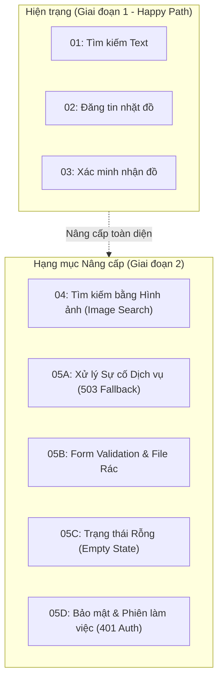

# Kế hoạch Nâng cấp Toàn diện Bộ Kiểm thử E2E Playwright (Phiên bản 2.1)

> **Tài liệu:** Kế hoạch Nâng cấp & Mở rộng Kiểm thử (Test Enhancement Plan)  
> **Dự án:** Findie - Nền tảng Tìm kiếm Đồ thất lạc Thông minh  
> **Mục tiêu:** Bổ sung kịch bản Tìm kiếm bằng hình ảnh (Image Search) và các kịch bản kiểm thử trường hợp lỗi/ngoại lệ (Sad Path & Error Handling) trên giao diện Playwright.  
> **Trạng thái:** Sẵn sàng triển khai (Ready for Implementation)

---

## 1. Mục tiêu & Khoảng trống Cần Nâng cấp



### 1.1 Hiện trạng
- Đã hoàn thành 3 kịch bản cốt lõi (`01-search-flow`, `02-item-post`, `03-claim-verify`) với dữ liệu giả lập chuẩn xác qua `mockApi.ts`.
- Pipeline CI trên GitHub Actions đã được sửa lỗi cấu hình và sẵn sàng chạy tự động.

### 1.2 Khoảng trống cần bổ sung
1. **Tìm kiếm bằng hình ảnh (Image Search):** Chưa có kịch bản mô phỏng người dùng kéo thả hoặc tải ảnh chụp đồ vật để tìm kiếm tương đồng trên giao diện.
2. **Kịch bản sự cố hệ thống (System Outage / 503 Fallback):** Chưa kiểm tra giao diện ứng xử thế nào khi AI Service bị sập hoặc quá tải.
3. **Kiểm tra tính hợp lệ dữ liệu (Form & Input Validation):** Chưa kiểm tra các thông báo lỗi khi để trống trường bắt buộc, tải lên file không hợp lệ (`.exe`, `.pdf`), hoặc ảnh vượt quá kích thước cho phép.
4. **Trạng thái không có kết quả (Empty State):** Chưa kiểm tra giao diện hiển thị khi không tìm thấy kết quả nào phù hợp.
5. **Xử lý phiên làm việc & Phân quyền (Authentication / 401 Unauthorized):** Chưa kiểm tra luồng chặn truy cập khi người dùng chưa đăng nhập bấm vào các tính năng yêu cầu tài khoản.

---

## 2. Thiết kế Kỹ thuật Chi tiết

### 2.1 Mở rộng Bộ Mock Mạng (`apps/web/e2e/utils/mockApi.ts`)
Nâng cấp hàm `setupDefaultApiMocks` để hỗ trợ cờ giả lập sự cố (Fault Injection Flags):

```typescript
export type MockScenarioOptions = {
  user?: MockUser | null;
  items?: any[];
  aiServiceAvailable?: boolean;       // false: Giả lập AI Service 503 Service Unavailable
  authStatus?: 'authenticated' | 'unauthorized' | 'token-expired';
  searchDelayMs?: number;            // Giả lập độ trễ mạng để test loading spinner
};
```

### 2.2 Đặc tả Chi tiết các Kịch bản Kiểm thử Mới

#### 🔹 Spec 04: Tìm kiếm bằng hình ảnh (`04-image-search.spec.ts`)
- **Kịch bản 4.1: Tải ảnh thành công và hiển thị danh sách xếp hạng tương đồng**
  - Mở trang `/search`.
  - Chuyển sang tab hoặc click vào khu vực "Tìm kiếm bằng hình ảnh".
  - Tải lên tệp ảnh mẫu `e2e/fixtures/sample-item.jpg`.
  - **Assert:**
    - Trình duyệt hiển thị ảnh preview vừa tải lên.
    - Hiển thị loading skeleton trong lúc xử lý.
    - Danh sách kết quả hiển thị các thẻ đồ vật với nhãn độ tương đồng (ví dụ: "Độ khớp 95%").
- **Kịch bản 4.2: Tải nhiều ảnh cùng lúc**
  - Tải lên 2-3 ảnh của cùng một góc chụp.
  - **Assert:** Hiển thị đủ các thumbnail ảnh nhỏ và nút xóa từng ảnh.

---

#### 🔹 Spec 05: Kiểm thử Trường hợp Lỗi & Ngoại lệ (`05-error-handling.spec.ts`)

- **Kịch bản 5.1: Xử lý khi AI Service bị gián đoạn (503 Service Unavailable)**
  - Cấu hình `page.route('**/api/search', route => route.fulfill({ status: 503 }))`.
  - Thực hiện tìm kiếm thông minh từ trang chủ hoặc trang search.
  - **Assert:**
    - Không bị sập màn hình (No blank page / No React Error Boundary).
    - Hiển thị banner cảnh báo: *"Dịch vụ tìm kiếm thông minh đang gián đoạn"*.
    - Hiển thị nút hoặc tự động chuyển về chế độ tìm kiếm cơ bản (Basic/Text Search Fallback).

- **Kịch bản 5.2: Kiểm tra Form Validation khi Đăng bài (`PostItemPage`)**
  - Mở trang `/post`.
  - Bỏ trống trường "Tên món đồ", không chọn ảnh, nhấn ngay nút "Tiếp tục".
  - **Assert:**
    - Form không cho phép chuyển bước.
    - Hiển thị thông báo lỗi màu đỏ ngay dưới input: *"Vui lòng nhập tên món đồ"* và *"Cần ít nhất 1 ảnh chụp"*.

- **Kịch bản 5.3: Tải lên tệp tin không hợp lệ**
  - Thử chọn file có định dạng không được phép (tạo file giả lập `test.pdf` hoặc `test.exe`).
  - **Assert:** Hiển thị toast lỗi: *"Chỉ chấp nhận ảnh định dạng JPEG, PNG hoặc WebP"*.

- **Kịch bản 5.4: Tìm kiếm không có kết quả (Empty State)**
  - Nhập chuỗi từ khóa vô nghĩa: `"xyz999khôngthểtìmgặpmónnày123"`.
  - **Assert:**
    - Hiển thị hình ảnh minh họa Empty State.
    - Hiển thị thông điệp: *"Không tìm thấy kết quả phù hợp"*.
    - Hiển thị gợi ý: *"Thử điều chỉnh bộ lọc hoặc đăng tin báo mất đồ"*.

- **Kịch bản 5.5: Người dùng chưa đăng nhập thực hiện thao tác nhạy cảm**
  - Giả lập `user: null` (Session 401).
  - Người dùng truy cập trang xem chi tiết và bấm *"Gửi yêu cầu nhận đồ"*.
  - **Assert:** Hệ thống hiển thị modal nhắc nhở hoặc chuyển hướng sang liên kết đăng nhập Google/Single Sign-On.

---

## 3. Lộ trình Triển khai (WBS - 4 Bước)

```
LỘ TRÌNH THỰC HIỆN
│
├── Bước 1: Mở rộng Mock API & Page Objects
│   ├── 1.1 Cập nhật apps/web/e2e/utils/mockApi.ts (hỗ trợ cờ lỗi 503, 401, mock image search API)
│   ├── 1.2 Bổ sung locators trong SearchPage.ts (Image input dropzone, Error banner, Empty state box)
│   └── 1.3 Bổ sung locators trong PostItemPage.ts (Validation error messages)
│
├── Bước 2: Xây dựng Spec 04 - Tìm kiếm bằng hình ảnh
│   ├── 2.1 Viết apps/web/e2e/specs/04-image-search.spec.ts
│   └── 2.2 Kiểm thử chạy đơn lẻ: npx playwright test 04-image-search.spec.ts
│
├── Bước 3: Xây dựng Spec 05 - Xử lý Lỗi & Ngoại lệ
│   ├── 3.1 Viết apps/web/e2e/specs/05-error-handling.spec.ts
│   └── 3.2 Kiểm thử chạy đơn lẻ: npx playwright test 05-error-handling.spec.ts
│
└── Bước 4: Tích hợp Toàn diện & Xác thực CI
    ├── 4.1 Chạy toàn bộ 5 specs: npm run test:e2e --prefix apps/web
    └── 4.2 Cập nhật tài liệu docs/guides/e2e-testing-guide.md
```

---

## 4. Tiêu chí Nghiệm thu (Definition of Done)

| Tiêu chí | Mô tả chi tiết |
| :--- | :--- |
| **Bao phủ 100% CUJs** | Đầy đủ 5 file specs bao gồm cả Happy Path và Sad Path (Lỗi mạng, Lỗi form, Lỗi auth). |
| **Độ ổn định (Zero Flakiness)** | Chạy lặp lại 3 lần liên tiếp ở chế độ headless không có bất kỳ kịch bản nào bị fail ngẫu nhiên. |
| **Thời gian thực thi** | Toàn bộ 5 kịch bản E2E hoàn thành trong thời gian **dưới 45 giây** nhờ cơ chế Mocked API tối ưu. |
| **Chất lượng mã nguồn** | Không có lỗi TypeScript (`tsc --noEmit`), giữ vững cấu trúc Page Object Model (POM). |
