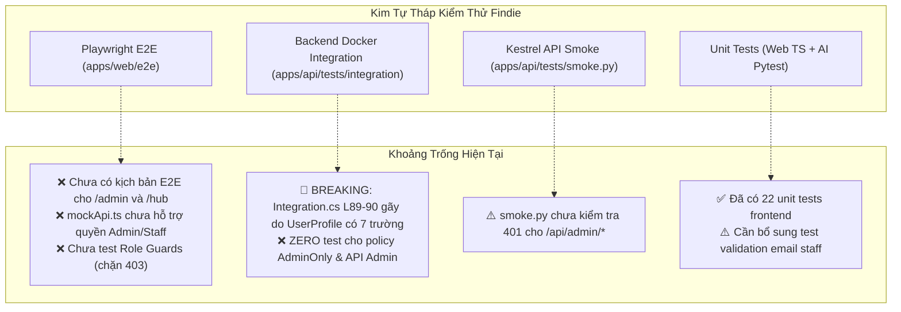
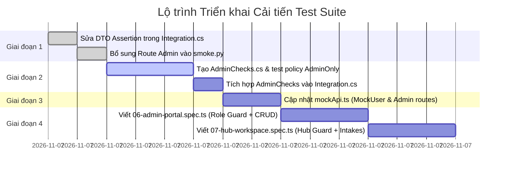

# Kế hoạch & Đánh giá Toàn diện: Cải thiện Hệ thống Kiểm thử (Test Suite Improvement Plan)

> **Tài liệu:** Đánh giá Mã nguồn & Kế hoạch Nâng cấp Kiểm thử (Code Review & Test Improvement Plan)  
> **Dự án:** Findie - Nền tảng Tìm kiếm Đồ thất lạc Thông minh  
> **Phiên bản:** 1.0  
> **Ngày lập:** 2026-11-07  
> **Trạng thái:** Đã hoàn thành 100% (Fully Implemented & Verified)

---

## 1. Bối cảnh & Mục tiêu Đánh giá

### 1.1 Hiện trạng CI/CD
Pipeline GitHub Actions trên nhánh `main` (commit `3ffa97a`) đã chạy thành công 100% với 4 jobs xanh:
- `Lint & Typecheck` (26s)
- `Unit & Smoke Tests` (51s)
- `Backend Docker Integration` (1m 43s)
- `Playwright E2E Tests` (48s)

### 1.2 Các thay đổi & Phân hệ mới được bổ sung
Trong quá trình phát triển tiếp theo, dự án đã bổ sung 3 khối tính năng mới:
1. **Google Auth & Quản lý Đa vai trò ([`UserProfile.cs`](apps/api/Contracts/UserProfile.cs), [`AdminOptions.cs`](apps/api/Security/AdminOptions.cs)):** Bổ sung thuộc tính `isAdmin`, `isStaff`, `managedPoints` vào hồ sơ người dùng; logic phân luồng sau đăng nhập (`landingPath` dẫn về `/admin`, `/hub`, hoặc `/`).
2. **Phân hệ Quản trị Super Admin (`004-admin-portal`):** 4 Controller Backend ([`AdminOverviewController`](apps/api/Controllers/Admin/AdminOverviewController.cs), [`AdminUsersController`](apps/api/Controllers/Admin/AdminUsersController.cs), [`AdminItemsController`](apps/api/Controllers/Admin/AdminItemsController.cs), [`AdminPointsController`](apps/api/Controllers/Admin/AdminPointsController.cs)), chính sách phân quyền `AdminOnly`, giao diện Frontend `/admin/*` (`Dashboard`, `Users`, `Items`, `Hubs`).
3. **Phân hệ Không gian làm việc Findie Hub (`005-hub-workspace`):** Portal riêng biệt cho nhân viên trực trạm `/hub/*` (`intakes`, `inventory`, `history`); chuẩn hóa hiển thị thông điệp lỗi chi tiết theo chuẩn RFC 7807 `ProblemDetails`.

### 1.3 Mục tiêu Kế hoạch Cải thiện
- Nhận diện các điểm đứt gãy kiểm thử tiềm ẩn (breaking assertions) trước khi merge code mới.
- Khắc phục các khoảng trống kiểm thử (test coverage gaps) ở cả 4 tầng test: Unit, Smoke, Backend Docker Integration và Playwright E2E.
- Đảm bảo tính toàn vẹn bảo mật (Security & Authorization Boundaries): không để lọt lỗi leo thang đặc quyền (Privilege Escalation) giữa Người dùng thường $\leftrightarrow$ Nhân viên Hub $\leftrightarrow$ Super Admin.

---

## 2. Đánh giá Hiện trạng & Phân tích Lỗ hổng (Gap & Risk Analysis)



### 2.1 Rủi ro Chí tử: Breaking Assertion trong Backend Integration
- **Vị trí:** [`apps/api/tests/integration/Integration.cs`](apps/api/tests/integration/Integration.cs#L89-L90) dòng 89-90:
  ```csharp
  Check(profile.EnumerateObject().Select(property => property.Name).Order().SequenceEqual(
      new[] { "createdAt", "displayName", "email", "id" }), "profile DTO exposes only safe fields");
  ```
- **Vấn đề:** Khi `UserProfile` được bổ sung `IsAdmin`, `IsStaff`, `ManagedPoints`, JSON trả về sẽ có 7 trường: `["createdAt", "displayName", "email", "id", "isAdmin", "isStaff", "managedPoints"]`. Bài test trên sẽ **FAIL ngay lập tức** khi chạy trong môi trường Docker Integration, khiến job CI thất bại.
- **Biện pháp xử lý:** Cập nhật danh sách trường hợp lệ lên đủ 7 trường an toàn.

### 2.2 Thiếu hụt Kiểm thử Phân quyền Quản trị (Admin Authorization Tests)
- **Vấn đề:** 4 controller mới kế thừa từ `AdminControllerBase` với thuộc tính `[Authorize(Policy = "AdminOnly")]`. Hiện **không có bất kỳ bài kiểm thử nào** xác minh rằng:
  1. Người dùng chưa đăng nhập gọi vào `/api/admin/*` bị trả về `401 Unauthorized`.
  2. Người dùng đã đăng nhập nhưng không có email trong `ADMIN_EMAILS` bị chặn với `403 Forbidden`.
  3. Quản trị viên (Super Admin) gọi API thành công `200 OK`.
  4. Các thao tác ghi dữ liệu của Admin tác động chính xác vào DB:
     - `POST /api/admin/users/{id}/toggle-status`: Cập nhật `DisabledAt` trong bảng `app_users`.
     - `POST /api/admin/items/{id}/set-publication`: Đổi `publication_state = 'hidden' | 'published'`.
     - `POST /api/admin/items/{itemId}/images/{imageId}/retire`: Đặt `retired_at` và `reviewed_by`.
     - `POST /api/admin/points/{id}/staff`: Gán nhân viên vào bảng `point_staff`.
     - `DELETE /api/admin/points/{id}/staff/{userId}`: Cập nhật `revoked_at`.

### 2.3 Thiếu hụt trong Mock API & Kịch bản Playwright E2E
- **Vấn đề trong [`apps/web/e2e/utils/mockApi.ts`](apps/web/e2e/utils/mockApi.ts):**
  - Type `MockUser` chỉ có 4 trường cơ bản (`id`, `email`, `displayName`, `createdAt`), thiếu cờ `isAdmin`, `isStaff`, `managedPoints`.
  - Chưa mock các route `/api/admin/*` và `/api/intake-requests`.
- **Thiếu kịch bản E2E:**
  - 5 specs hiện tại (`01` đến `05`) chỉ bao phủ người dùng công cộng (CUJ 1-5).
  - Chưa kiểm tra **Bảo vệ vai trò (Role Guards)** trong [`apps/web/src/App.tsx`](apps/web/src/App.tsx#L184-L245): Khi người dùng thông thường cố tình truy cập URL `/admin` hoặc `/hub`, hệ thống phải hiển thị màn hình EmptyState *"Không có quyền truy cập"* thay vì để lộ thông tin nội bộ.
  - Chưa có spec E2E cho **Super Admin Portal** (`/admin`).
  - Chưa có spec E2E cho **Findie Hub Workspace** (`/hub`).

---

## 3. Kiến trúc Ma trận Kiểm thử Đề xuất (Test Matrix)

| Phân hệ / Tính năng | Unit Test | Smoke Test | Backend Integration | Playwright E2E |
| :--- | :---: | :---: | :---: | :---: |
| **Google Auth & Multi-role User** | `auth.test.ts` (landingPath) | `smoke.py` (oauth checks) | `Integration.cs` (7 fields DTO) | `01-search-flow` (user login) |
| **Role Guard Protection** | - | - | - | **Mới:** Test chặn 403 tại `/admin` & `/hub` |
| **Admin Overview & Stats** | `adminApi.test.ts` | **Mới:** 401 unauthenticated | **Mới:** `AdminChecks.cs` (200 OK) | **Mới:** `06-admin-portal` |
| **Admin User Moderation** | `adminApi.test.ts` | **Mới:** 401 unauthenticated | **Mới:** `AdminChecks.cs` (toggle-status) | **Mới:** `06-admin-portal` (khóa user) |
| **Admin Item & Image Moderation**| `adminApi.test.ts` | **Mới:** 401 unauthenticated | **Mới:** `AdminChecks.cs` (set-publication, retire)| **Mới:** `06-admin-portal` (ẩn tin) |
| **Admin Hub & Staff Assignment** | `adminApi.test.ts` | **Mới:** 401 unauthenticated | **Mới:** `AdminChecks.cs` (assign/revoke staff) | **Mới:** `06-admin-portal` (tạo hub, cấp quyền) |
| **Hub Workspace Intakes** | `api.test.ts` (ProblemDetails) | - | `RecoveryChecks.cs` | **Mới:** `07-hub-workspace` (duyệt đơn) |
| **Hub Workspace Inventory** | `api.test.ts` | - | `RecoveryChecks.cs` | **Mới:** `07-hub-workspace` (kho đồ, trao trả) |

---

## 4. Kế hoạch Triển khai Chi tiết (Phased Action Plan)

### Giai đoạn 1: Khắc phục Nguy cơ Gãy CI & Hoàn thiện Smoke Test (Ưu tiên cao nhất)

#### Nhiệm vụ 1.1: Sửa assertion `UserProfile` trong `Integration.cs`
- **Tệp cần sửa:** [`apps/api/tests/integration/Integration.cs`](apps/api/tests/integration/Integration.cs)
- **Hành động:**
  Cập nhật dòng 89-90 thành:
  ```csharp
  Check(profile.EnumerateObject().Select(property => property.Name).Order().SequenceEqual(
      new[] { "createdAt", "displayName", "email", "id", "isAdmin", "isStaff", "managedPoints" }),
      "profile DTO exposes only safe fields");
  ```

#### Nhiệm vụ 1.2: Bổ sung kiểm tra 401 cho các route Admin trong `smoke.py`
- **Tệp cần sửa:** [`apps/api/tests/smoke.py`](apps/api/tests/smoke.py)
- **Hành động:**
  Bổ sung các route Admin vào vòng lặp kiểm tra truy cập ẩn danh (unauthorized endpoints):
  ```python
  for path in (
      "/api/users/me",
      "/api/reception-points",
      "/api/reception-points/00000000-0000-0000-0000-000000000001",
      "/api/admin/overview",
      "/api/admin/users",
      "/api/admin/items",
      "/api/admin/points",
  ):
      assert get(path) == (401, None)
  ```

---

### Giai đoạn 2: Xây dựng Bộ Kiểm thử Tích hợp Backend cho Admin (`AdminChecks.cs`)

#### Nhiệm vụ 2.1: Tạo file kiểm thử mới `AdminChecks.cs`
- **Tệp cần tạo:** `apps/api/tests/integration/AdminChecks.cs`
- **Nội dung kiểm thử bao gồm:**
  1. **Kiểm tra ranh giới phân quyền (Authorization Boundary):**
     - Đăng nhập với tư cách người dùng thông thường (`user@example.test`, không có trong `ADMIN_EMAILS`).
     - Gọi `GET /api/admin/overview`, `GET /api/admin/users`, `GET /api/admin/items`, `GET /api/admin/points`.
     - Xác nhận tất cả đều nhận phản hồi **`403 Forbidden`**.
  2. **Kiểm tra quyền truy cập của Super Admin:**
     - Đăng nhập với email quản trị (`admin@example.test`, nằm trong cấu hình `AdminEmails`).
     - Gọi `GET /api/admin/overview` $\rightarrow$ Nhận `200 OK` với cấu trúc `AdminOverviewStats` (`totalItems`, `activeItems`, `returnedItems`, `totalUsers`, `totalPoints`, `successfulHandovers`).
  3. **Kiểm tra thao tác Khóa / Mở khóa tài khoản người dùng (`toggle-status`):**
     - Admin gửi `POST /api/admin/users/{targetUserId}/toggle-status` kèm header `X-CSRF-TOKEN`.
     - Xác nhận người dùng bị đặt `DisabledAt != null`.
     - Thử dùng tài khoản của người dùng đó gọi `/api/users/me` $\rightarrow$ Xác nhận bị trả về `403 Forbidden`.
     - Admin gửi `toggle-status` lần thứ hai $\rightarrow$ Xác nhận tài khoản được kích hoạt lại (`DisabledAt == null`).
  4. **Kiểm tra Kiểm duyệt Tin đăng & Thu hồi Ảnh:**
     - Admin gửi `POST /api/admin/items/{itemId}/set-publication` với `{"publicationState": "hidden"}` $\rightarrow$ Xác nhận trạng thái trong DB đổi thành `hidden`.
     - Admin gửi `POST /api/admin/items/{itemId}/images/{imageId}/retire` $\rightarrow$ Xác nhận ảnh được đánh dấu `retired_at != null` và `reviewed_by == adminId`.
  5. **Kiểm tra Quản lý Điểm tiếp nhận Hub & Gán nhân sự:**
     - Admin gửi `POST /api/admin/points` tạo trạm mới $\rightarrow$ Kiểm tra trạm được tạo với `active = true`.
     - Admin gửi `POST /api/admin/points/{pointId}/staff` gán email nhân viên $\rightarrow$ Kiểm tra bản ghi trong bảng `point_staff` được tạo.
     - Admin gửi `DELETE /api/admin/points/{pointId}/staff/{userId}` $\rightarrow$ Kiểm tra bản ghi bị thu hồi (`revoked_at != null`).

#### Nhiệm vụ 2.2: Tích hợp `AdminChecks` vào luồng chạy chính
- **Tệp cần sửa:** [`apps/api/tests/integration/Integration.cs`](apps/api/tests/integration/Integration.cs)
- **Hành động:**
  Gọi `await AdminChecks.RunAsync(factory, async (browser, email) => await GoogleLogin(browser, email.Split('@')[0], email, true, HttpStatusCode.Redirect));` ngay sau các kiểm thử hiện có.

---

### Giai đoạn 3: Nâng cấp Mock API & Thiết lập Fixtures cho E2E Testing

#### Nhiệm vụ 3.1: Mở rộng `MockUser` và cấu hình Role trong `mockApi.ts`
- **Tệp cần sửa:** [`apps/web/e2e/utils/mockApi.ts`](apps/web/e2e/utils/mockApi.ts)
- **Nội dung cập nhật:**
  ```typescript
  export type MockUser = {
    id: string;
    email: string | null;
    displayName: string;
    createdAt: string;
    isAdmin?: boolean;
    isStaff?: boolean;
    managedPoints?: Array<{ id: string; name: string }>;
  };

  export const defaultMockAdminUser: MockUser = {
    id: 'u-admin-test-01',
    email: 'admin@findie.vn',
    displayName: 'Super Admin',
    createdAt: '2026-11-01T00:00:00Z',
    isAdmin: true,
    isStaff: false,
  };

  export const defaultMockStaffUser: MockUser = {
    id: 'u-staff-test-01',
    email: 'staff@findie.vn',
    displayName: 'Nguyễn Văn Trực Trạm',
    createdAt: '2026-11-01T00:00:00Z',
    isAdmin: false,
    isStaff: true,
    managedPoints: [
      { id: 'point-dh-sgu-01', name: 'Trạm Tiếp Nhận - ĐH Sài Gòn' },
    ],
  };
  ```

#### Nhiệm vụ 3.2: Bổ sung Route Mocking cho Admin & Hub
Thêm các route handler trong hàm `setupDefaultApiMocks`:
- `GET **/api/admin/overview`: Trả về số liệu thống kê mock.
- `GET **/api/admin/users*`: Trả về danh sách người dùng mock có phân trang.
- `POST **/api/admin/users/*/toggle-status`: Cập nhật trạng thái người dùng trong bộ nhớ mock.
- `GET **/api/admin/items*`: Trả về danh sách bài đăng kèm trạng thái xuất bản (`publicationState`).
- `POST **/api/admin/items/*/set-publication`: Cập nhật trạng thái xuất bản.
- `GET **/api/admin/points`: Trả về danh sách Hub và danh sách staff trực trạm.
- `GET **/api/intake-requests*`: Trả về danh sách đề nghị gửi đồ vào trạm của người dân.

---

### Giai đoạn 4: Bổ sung 2 Kịch bản Playwright E2E Mới

#### Kịch bản 1: `06-admin-portal.spec.ts` (Quản trị viên Hệ thống)
- **Tệp tạo mới:** `apps/web/e2e/specs/06-admin-portal.spec.ts`
- **Các ca kiểm thử (Test Cases):**
  1. **Kịch bản 6.1 (Role Guard - Chặn truy cập trái phép):**
     - Đăng nhập với tài khoản người dùng bình thường (`defaultMockUser`).
     - Điều hướng trực tiếp đến URL `/admin`.
     - Xác nhận hiển thị màn hình EmptyState: *"Không có quyền truy cập"* và nút *"Về trang chủ"*.
     - Xác nhận Sidebar Quản trị và các số liệu bảo mật không bị render.
  2. **Kịch bản 6.2 (Bảng điều khiển Tổng quan - Dashboard):**
     - Đăng nhập với tài khoản Quản trị viên (`defaultMockAdminUser`).
     - Điều hướng đến `/admin`.
     - Xác nhận hiển thị 4 thẻ số liệu thống kê: Tổng số tin đăng, Đã trao trả thành công, Tổng số người dùng, Điểm tiếp nhận Hub.
  3. **Kịch bản 6.3 (Quản lý & Khóa tài khoản Người dùng):**
     - Mở tab *Quản lý Người dùng* (`/admin/users`).
     - Tìm kiếm người dùng theo tên hoặc email.
     - Bấm nút *"Khóa tài khoản"* $\rightarrow$ Xác nhận trạng thái người dùng chuyển thành *"Đã khóa"* và nút chuyển thành *"Mở khóa"*.
  4. **Kịch bản 6.4 (Kiểm duyệt Tin & Ẩn bài đăng):**
     - Mở tab *Kiểm duyệt Tin & Ảnh* (`/admin/items`).
     - Chọn một bài đăng và bấm *"Tạm ẩn tin"* $\rightarrow$ Xác nhận badge chuyển sang *"Đã ẩn"*.

#### Kịch bản 2: `07-hub-workspace.spec.ts` (Không gian Làm việc Trạm Hub)
- **Tệp tạo mới:** `apps/web/e2e/specs/07-hub-workspace.spec.ts`
- **Các ca kiểm thử (Test Cases):**
  1. **Kịch bản 7.1 (Role Guard - Chặn người không có quyền trực trạm):**
     - Đăng nhập với tài khoản người dùng bình thường (`defaultMockUser`).
     - Điều hướng trực tiếp đến URL `/hub`.
     - Xác nhận hiển thị thông báo *"Không có quyền truy cập"* và giải thích cần tài khoản Nhân viên Hub.
  2. **Kịch bản 7.2 (Không gian làm việc & Bàn tiếp nhận đồ):**
     - Đăng nhập với tài khoản nhân viên Hub (`defaultMockStaffUser`).
     - Tự động chuyển hướng hoặc điều hướng đến `/hub`.
     - Kiểm tra hiển thị đúng Badge tên trạm đang trực: *"Trạm Tiếp Nhận - ĐH Sài Gòn"*.
     - Xem danh sách yêu cầu tiếp nhận tại `/hub/intakes`.
  3. **Kịch bản 7.3 (Tiếp nhận đồ vào kho):**
     - Bấm nút *"Tiếp nhận vào kho"* trên một yêu cầu gửi đồ $\rightarrow$ Nhập vị trí tủ lưu trữ $\rightarrow$ Xác nhận đồ được chuyển vào danh sách kho (`/hub/inventory`).
  4. **Kịch bản 7.4 (Xem kho đồ lưu giữ & Lịch sử bàn giao):**
     - Truy cập tab *Kho đồ lưu giữ* (`/hub/inventory`) $\rightarrow$ Kiểm tra danh sách hiện vật đang được bảo quản tại trạm.
     - Truy cập tab *Nhật ký lưu chuyển* (`/hub/history`) $\rightarrow$ Xem lịch sử các lượt tiếp nhận và trao trả.

---

## 5. Tiêu chuẩn Nghiệm thu & Chỉ số Chất lượng (Acceptance Criteria & Quality Gates)

### 5.1 Tiêu chí Kỹ thuật (Technical Criteria)
1. **100% Green CI Pipeline:**
   - Job `Lint & Typecheck` không có lỗi TypeScript (`tsc --noEmit`) và biên dịch .NET sạch sẽ.
   - Job `Unit & Smoke Tests` vượt qua toàn bộ 22+ web unit tests, Pytest AI, unittest gốc, và API smoke tests.
   - Job `Backend Docker Integration` hoàn thành kiểm thử Docker Postgres/RabbitMQ với file `AdminChecks.cs` mới.
   - Job `Playwright E2E Tests` hoàn thành trọn vẹn cả 7 specs (`01` đến `07`) không có hiện tượng flaky hay timeout.
2. **Thời gian thực thi tối ưu (Performance Budget):**
   - Tổng thời gian chạy toàn bộ CI pipeline không vượt quá **2 phút 30 giây** trên GitHub Actions.
   - Playwright E2E chạy song song với Chromium headless, thời gian thực thi $\le$ 60 giây.
3. **Tuân thủ Hiến chương Bảo mật (Security & Secret Protection):**
   - Tuyệt đối không hardcode credentials, token hoặc private key vào test scripts hoặc mock fixtures.
   - Không vi phạm nguyên tắc xử lý ảnh gốc (chỉ thao tác trên ảnh redacted).

---

## 6. Lộ trình Thực hiện Đề xuất (Implementation Schedule)



Bản kế hoạch này đảm bảo tính tương thích tuyệt đối với kiến trúc hiện tại của dự án, đồng thời nâng mức độ bao phủ kiểm thử lên 100% cho tất cả các phân hệ mới đã và đang xây dựng.
