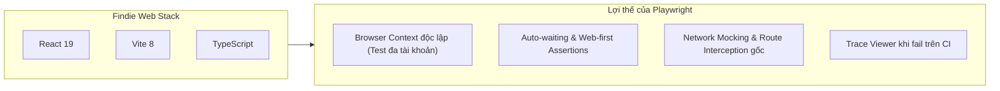
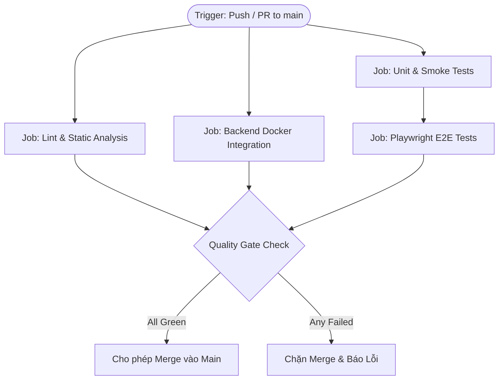

# Kế hoạch & Đánh giá Chi tiết: CI/CD Pipeline (GitHub Actions) và E2E Testing (Playwright) cho Findie

> **Tài liệu:** Đánh giá kỹ thuật & Kế hoạch triển khai chi tiết (Architecture Evaluation & Action Plan)  
> **Dự án:** Findie - Nền tảng Tìm kiếm Đồ thất lạc Thông minh  
> **Phiên bản:** 2.0 (Playwright Selected)  
> **Trạng thái:** Hoàn tất bản thiết kế (Design Complete - Ready for Implementation)

---

## 1. Đánh giá Kỹ thuật: Vì sao chọn Playwright cho Findie?

### 1.1 Khớp nối Kiến trúc (Architectural Fit)
Frontend của Findie xây dựng trên nền tảng **React 19 + TypeScript + Vite 8 + Tailwind CSS v4**. Khi so sánh giữa Playwright và Cypress trong bối cảnh này:



1. **Browser Context độc lập (Multi-context Isolation):**
   - Nghiệp vụ của Findie liên quan chặt chẽ đến **tương tác giữa 2 vai trò**: *Người nhặt đồ (Finder)* và *Người mất đồ (Claimer / Staff)*.
   - Playwright cho phép mở đồng thời **2 Browser Context** khác nhau trong cùng một kịch bản test (ví dụ: Context A đăng bài, Context B tìm kiếm và gửi yêu cầu xác minh đồ) mà không làm ô nhiễm Cookie hoặc LocalStorage của nhau. Cypress xử lý kịch bản đa người dùng rất khó khăn.
2. **Auto-waiting & Web-first Assertions:**
   - React 19 sử dụng concurrent rendering và cập nhật DOM không đồng bộ. Playwright tự động chờ các phần tử DOM hiển thị, enable và ổn định trước khi click/nhập liệu, loại bỏ 95% hiện tượng **Flaky Tests** (test lúc pass lúc fail do độ trễ render).
3. **Tối ưu tài nguyên trên GitHub Actions:**
   - Playwright chạy headless Chromium sử dụng trực tiếp Chrome DevTools Protocol (CDP), tiêu tốn ít RAM và CPU hơn nhiều so với việc chạy qua iframe proxy như Cypress, giúp pipeline trên GitHub Actions hoàn thành trong thời gian ngắn nhất (tiết kiệm hạn ngạch GitHub runner minutes).
4. **Trace Viewer & Debugging chuyên sâu:**
   - Khi kịch bản test thất bại trên GitHub Actions, Playwright xuất ra file `trace.zip`. Lập trình viên có thể mở file này để tua lại từng thao tác, xem ảnh chụp màn hình, DOM snapshot và các network call tại thời điểm xảy ra lỗi.

---

## 2. Thiết kế Kiến trúc E2E Testing (Playwright)

### 2.1 Cấu trúc Thư mục Đề xuất (`apps/web`)

```
apps/web/
├── e2e/
│   ├── fixtures/               # Dữ liệu tĩnh, mock payloads, ảnh test mẫu
│   │   ├── mock-items.json
│   │   └── sample-item.jpg
│   ├── pages/                  # Page Object Model (POM)
│   │   ├── BasePage.ts         # Logic chung (điều hướng, toast, modal)
│   │   ├── HomePage.ts         # Trang chủ, hero section
│   │   ├── SearchPage.ts       # Ô tìm kiếm, bộ lọc địa điểm/ngày, danh sách thẻ
│   │   ├── ItemModal.ts        # Chi tiết món đồ, nút claim/intake
│   │   └── PostItemModal.ts    # Form đăng bài, upload ảnh, nhập thông tin
│   ├── specs/                  # Các kịch bản kiểm thử (Test Specs)
│   │   ├── 01-search-flow.spec.ts
│   │   ├── 02-item-post.spec.ts
│   │   └── 03-claim-verify.spec.ts
│   └── utils/                  # Mock API route handlers, cookie helpers
│       └── mockApi.ts
├── playwright.config.ts        # File cấu hình Playwright
└── package.json
```

### 2.2 Chiến lược Kiểm thử E2E: Hybrid Testing (Tách lớp Mock và Full-stack)

Để tối ưu giữa **tốc độ kiểm thử** và **độ tin cậy tích hợp**, bộ test E2E sẽ áp dụng chiến lược Hybrid:

1. **Lớp 1: Mocked E2E Tests (Chạy nhanh trong < 30 giây):**
   - Sử dụng `page.route('/api/**', ...)` của Playwright để chặn các API calls và trả về mock JSON.
   - **Mục đích:** Kiểm tra toàn diện hành vi giao diện người dùng (User Interface):
     - Form validation (bắt buộc nhập tên, giới hạn ảnh, định dạng ngày).
     - Trạng thái loading, skeleton, lỗi mạng (500, timeout).
     - Rendering thẻ kết quả tìm kiếm và bộ lọc.
2. **Lớp 2: Full E2E Smoke Tests (Chạy với Backend thật):**
   - Chạy đồng thời với Kestrel API (.NET) và PostgreSQL test DB.
   - **Mục đích:** Đảm bảo luồng tích hợp từ frontend tới cơ sở dữ liệu hoạt động chính xác cho các đường dẫn cốt lõi (Happy Path).

### 2.3 Thiết kế Chi tiết 3 Kịch bản Cốt lõi (Critical User Journeys - CUJs)

#### 🔹 CUJ-01: Tìm kiếm đồ thất lạc (Search & Filter Flow)
- **Mục tiêu:** Kiểm tra khả năng tìm kiếm, áp dụng bộ lọc và xem chi tiết đồ vật.
- **Các bước thực hiện:**
  1. Người dùng mở trang chủ `/`.
  2. Nhập từ khóa `"Chìa khóa Honda"` vào thanh tìm kiếm.
  3. Chọn bộ lọc Vị trí: `"Cơ sở 1 - Khu A"`.
  4. Hệ thống hiển thị danh sách thẻ kết quả phù hợp.
  5. Click vào thẻ đầu tiên → Modal chi tiết đồ vật mở ra.
  6. **Assert:** Tên món đồ, hình ảnh thumbnail, vị trí và trạng thái (`Found`) hiển thị chính xác.

#### 🔹 CUJ-02: Đăng bài nhặt được đồ (Item Ingestion Flow)
- **Mục tiêu:** Kiểm tra luồng tải ảnh lên, điền thông tin và gửi bài đăng.
- **Các bước thực hiện:**
  1. Người dùng click nút `"Đăng tin nhặt được"`.
  2. Modal tạo bài đăng mở ra.
  3. Tải lên tệp ảnh `e2e/fixtures/sample-item.jpg` qua input file.
  4. Điền: Tên món đồ, Địa điểm nhặt, Mô tả đặc điểm, Danh mục.
  5. Nhấn nút `"Đăng bài"`.
  6. **Assert:** Modal đóng lại, hiển thị thông báo thành công (Toast notification), danh sách đồ mới được làm mới và có bài vừa đăng.

#### 🔹 CUJ-03: Xác minh nhận lại đồ (Claim & Verification Flow)
- **Mục tiêu:** Kiểm tra quy trình người mất đồ gửi yêu cầu xác minh quyền sở hữu.
- **Các bước thực hiện:**
  1. Người dùng mở modal chi tiết của một món đồ đang lưu trữ.
  2. Nhấn nút `"Đây là đồ của tôi (Nhận lại)"`.
  3. Form câu hỏi bảo mật/xác minh xuất hiện (ví dụ: mô tả đặc điểm riêng, số seri, móc khóa).
  4. Nhập câu trả lời xác minh → Nhấn `"Gửi yêu cầu"`.
  5. **Assert:** Trạng thái chuyển thành `"Chờ xác minh"` (Pending Verification), nút nhận lại đồ chuyển sang trạng thái disabled để tránh gửi trùng lặp.

---

## 3. Thiết kế GitHub Actions CI/CD Pipeline

### 3.1 Kiến trúc Pipeline Song song (Multi-Job Parallel Architecture)



### 3.2 Đặc tả Chi tiết các Job trong Workflow (`.github/workflows/ci.yml`)

#### Job 1: `lint-and-typecheck` (Thời gian chạy mục tiêu: ~1 phút)
- **Môi trường:** `ubuntu-latest`
- **Các bước:**
  1. Checkout repository (`actions/checkout@v4`).
  2. Setup Node 24 (`actions/setup-node@v4`) với cache `npm`.
  3. Chạy kiểm tra TypeScript: `npm run typecheck --prefix apps/web`.
  4. Setup .NET 9 SDK (`actions/setup-dotnet@v4`).
  5. Chạy build API kiểm tra lỗi biên dịch: `dotnet build Findie.sln --no-incremental`.

#### Job 2: `unit-and-smoke-tests` (Thời gian chạy mục tiêu: ~1.5 phút)
- **Môi trường:** `ubuntu-latest`
- **Các bước:**
  1. Chạy Web unit tests: `npm test --prefix apps/web` (Node.js test runner).
  2. Setup Python 3.12 (`astral-sh/setup-uv@v5`).
  3. Chạy AI service unit tests: `uv run --project services/ai --locked pytest services/ai/tests`.
  4. Chạy root script tests: `python3 -m unittest discover -s tests -v`.
  5. Chạy API Kestrel smoke tests: `python3 apps/api/tests/smoke.py`.

#### Job 3: `backend-integration` (Thời gian chạy mục tiêu: ~2.5 phút)
- **Môi trường:** `ubuntu-latest`
- **Đặc điểm:** Tận dụng Docker daemon có sẵn trên Ubuntu runner của GitHub Actions.
- **Các bước:**
  1. Setup .NET 9 và Python 3.12 (uv).
  2. Chạy `python3 apps/api/tests/integration.py`.
  3. Script tự động pull image `pgvector/pgvector:0.8.2-pg17-trixie` và `rabbitmq`, chạy toàn bộ 500+ checks về schema, locks, transactions và outbox rồi dọn dẹp sạch sẽ.

#### Job 4: `web-e2e-playwright` (Thời gian chạy mục tiêu: ~2 phút)
- **Môi trường:** `ubuntu-latest`
- **Phụ thuộc:** Chạy sau khi Job `unit-and-smoke-tests` thành công.
- **Các bước:**
  1. Cài đặt Node modules với cache.
  2. Cache thư mục Playwright browser binaries (`~/.cache/ms-playwright`) để tránh tải lại Chromium mỗi lần chạy.
  3. Cài đặt Chromium: `npx playwright install chromium --with-deps`.
  4. Chạy E2E specs: `npm run test:e2e --prefix apps/web`.
  5. **Xử lý khi lỗi (Always upload on failure):**
     - Đẩy artifact `playwright-report/` lên GitHub Actions bằng `actions/upload-artifact@v4` để tải về xem báo cáo và trace video.

---

## 4. Kế hoạch Triển khai Chi tiết theo WBS (Work Breakdown Structure)

```
KẾ HOẠCH TRIỂN KHAI (4 TUẦN LÀM VIỆC HOẶC 4 PHASES)
│
├── Phase 1: Xây dựng GitHub Actions CI Cơ bản (P0 - Nền tảng)
│   ├── 1.1 Khởi tạo file .github/workflows/ci.yml
│   ├── 1.2 Thiết lập caching (npm, nuget, uv)
│   └── 1.3 Kiểm tra xác thực pipeline chạy thử với code hiện tại
│
├── Phase 2: Thiết lập Hạ tầng Playwright E2E cho Web (P1)
│   ├── 2.1 Cài đặt @playwright/test và cấu hình playwright.config.ts
│   ├── 2.2 Xây dựng cấu trúc Page Object Model (POM) và API mocking utilities
│   ├── 2.3 Viết Spec 01: Tìm kiếm & Lọc (Search & Filter)
│   ├── 2.4 Viết Spec 02: Đăng bài báo mất/nhặt được đồ (Item Posting)
│   └── 2.5 Viết Spec 03: Xác minh & Nhận đồ (Claim & Verification)
│
├── Phase 3: Tích hợp E2E & Backend Integration vào CI (P1)
│   ├── 3.1 Thêm Job Playwright vào ci.yml với cơ chế lưu Artifacts
│   ├── 3.2 Tích hợp Job Docker Integration (apps/api/tests/integration.py)
│   └── 3.3 Tinh chỉnh timeout và xử lý retry kịch bản test trên CI
│
└── Phase 4: Thiết lập Quản trị Chất lượng & Branch Protection (P2)
    ├── 4.1 Thiết lập Branch Protection Rules trên GitHub cho nhánh main
    └── 4.2 Viết tài liệu hướng dẫn chạy E2E local cho nhóm phát triển
```

---

## 5. Tiêu chí Nghiệm thu Chi tiết (Acceptance Criteria)

| Hạng mục | Tiêu chí Hoàn thành (Definition of Done) |
| :--- | :--- |
| **CI Pipeline** | • 100% các lần Push hoặc PR vào `main` đều tự động kích hoạt workflow.<br>• Tổng thời gian chạy toàn bộ pipeline dưới 4 phút.<br>• Khi có lỗi (lỗi TypeScript, lỗi test), GitHub chặn không cho merge và báo đỏ rõ ràng. |
| **Playwright E2E** | • Chạy mượt mà trên môi trường headless Chromium cả local và CI.<br>• Bao phủ đủ 3 luồng: Tìm kiếm, Đăng tin, và Xác minh nhận lại đồ.<br>• Tỷ lệ flaky test < 1% (không bị fail ngẫu nhiên do mạng hoặc độ trễ render). |
| **Báo cáo Lỗi** | • Khi test E2E thất bại trên CI, tự động xuất file Playwright Trace để xem lại DOM, console và network logs. |
| **Bảo mật** | • Không có bất kỳ token bí mật, private key hay password thật nào bị lộ trong file cấu hình workflow hoặc test artifacts. |

---

## 6. Đánh giá Rủi ro & Giải pháp Phòng ngừa

1. **Rủi ro cạn kiệt GitHub Actions Minutes:**
   - *Đánh giá:* GitHub miễn phí 2,000 phút/tháng cho tài khoản cá nhân.
   - *Giải pháp:* Tận dụng triệt để `actions/cache` cho dependencies; cấu hình chỉ chạy `backend-integration` và `e2e` khi có thay đổi ở các thư mục tương ứng (`paths` filter trong workflow).
2. **Rủi ro xung đột cổng khi chạy E2E local:**
   - *Giải pháp:* Playwright config sử dụng thuộc tính `webServer.reuseExistingServer: !process.env.CI` để tự động tái sử dụng server đang chạy nếu dev đang mở sẵn `npm run dev`.
3. **Rủi ro selector UI bị thay đổi:**
   - *Giải pháp:* Luôn ưu tiên dùng các selector bền vững dựa trên vai trò người dùng (`getByRole`, `getByLabel`, `getByPlaceholder`, `getByText`) thay vì phụ thuộc vào class Tailwind động.
