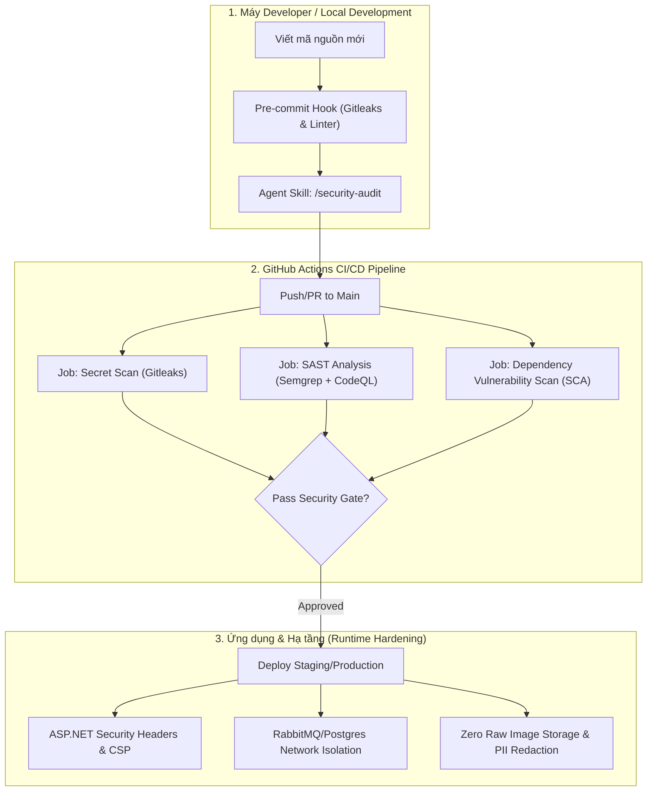

# Kế hoạch Tích hợp Semgrep, Gitleaks & Nâng cấp An ninh Dự án Findie

> **Trách nhiệm của Antigravity Agent:**
> - Xây dựng kiến trúc & kế hoạch an ninh dự phòng.
> - Thiết lập công cụ tự động (Gitleaks, Semgrep, SCA).
> - Trực tiếp Review code và phản biện bảo mật (Security Gatekeeper) cho mọi PR/thay đổi mã nguồn.

---

## 1. Bản đồ Kiến trúc An ninh (Security Architecture Map)

---

## 2. Kế hoạch Triển khai Gitleaks (Secret Prevention)

### Mục tiêu
Ngăn chặn tuyệt đối việc commit các khóa bí mật:
- `.env*` chứa mật khẩu database, token RabbitMQ, private key.
- Google OAuth Client Secret (`Authentication__Google__ClientSecret`).
- Cloudflare R2 Credentials (`Storage__SecretAccessKey`).
- Token nội bộ giữa .NET API và Python AI (`AI_SERVICE_TOKEN`).

### Các thành phần đã tạo
1. **File cấu hình:** [`.gitleaks.toml`](../../.gitleaks.toml)
   - Sử dụng bộ rule chuẩn của Gitleaks.
   - Whitelist file `.env.example`, mock keys trong thư mục `tests/fixtures/`, `node_modules/`, `bin/`, `obj/`.
2. **Kế hoạch tích hợp:**
   - **Local Hook:** Sử dụng `pre-commit` framework hoặc script git hook tại `.git/hooks/pre-commit` để quét staged files trước khi tạo commit (`gitleaks git --staged --config=.gitleaks.toml`).
   - **CI Pipeline:** Thêm step `gitleaks-action` vào `.github/workflows/ci.yml`.

---

## 3. Kế hoạch Triển khai Semgrep (SAST)

### Mục tiêu
Bắt sớm các lỗ hổng mã nguồn tĩnh trên toàn bộ 3 tầng công nghệ:
- **C# / .NET 10 (`apps/api`):** SQL Injection, Path Traversal, Insecure Deserialization, CSRF bypass, thiếu `[Authorize]`.
- **Python 3.12 (`services/ai`):** Bounded Pillow decompression, Command Injection, SSRF khi gọi Ollama/Colab gateway.
- **TypeScript / React 19 (`apps/web`):** XSS qua DOM manipulation, open redirect, lộ secret trong bundle client.

### Cấu hình Semgrep
1. **File ignore:** [`.semgrepignore`](../../.semgrepignore) loại bỏ build artifacts và node_modules.
2. **Rule đặc thù của Findie:** [`.semgrep/findie-rules.yml`](../../.semgrep/findie-rules.yml)
   - `findie-prevent-raw-image-disk-write`: Báo lỗi ngay nếu có code ghi byte ảnh gốc ra đĩa (`File.WriteAllBytes`, `FileStream`).
   - `findie-python-pillow-unbounded-open`: Cảnh báo nếu mở ảnh bằng Pillow mà không có giới hạn pixel DoS.
3. **Các bộ rule Semgrep chính thống áp dụng:**
   - `p/csharp`, `p/owasp-top-ten`
   - `p/python`, `p/fastapi`
   - `p/typescript`, `p/react`
   - `p/dockerfile`, `p/docker-compose`

---

## 4. Kế hoạch Sửa chữa & Gia cố An ninh (Remediation & Hardening Plan)

### Ưu tiên 1 (Cao nhất - Sửa ngay):
| Hạng mục | Vị trí file | Nội dung sửa đổi |
| :--- | :--- | :--- |
| **Bổ sung Security Headers** | `apps/api/Program.cs` | Thêm middleware chèn `X-Frame-Options: DENY`, `X-Content-Type-Options: nosniff`, `Referrer-Policy`, `HSTS`. |
| **Sửa ForwardedHeaders** | `apps/api/Program.cs` | Thêm cờ `ForwardedHeaders.XForwardedFor` để Rate Limiting nhận đúng IP client khi qua Cloudflare/Nginx. |
| **Cập nhật CI Pipeline** | `.github/workflows/ci.yml` | Thêm job quét bảo mật tự động: Gitleaks + `dotnet list --vulnerable` + `npm audit` + `pip-audit`. |

### Ưu tiên 2 (Trung bình):
| Hạng mục | Vị trí file | Nội dung sửa đổi |
| :--- | :--- | :--- |
| **Pillow Decompression Limit** | `services/ai/findie_ai/images.py` | Đặt tường minh `Image.MAX_IMAGE_PIXELS = 25_000_000` trước khi parse header. |
| **Linter bảo mật Frontend** | `apps/web/package.json` | Bổ sung script `npm run lint` với `eslint-plugin-security`. |
| **CORS Policy tường minh** | `apps/api/Program.cs` | Khai báo CORS policy nghiêm ngặt theo domain frontend được whitelist, không dùng wildcard khi có cookie session. |

---

## 5. Quy trình Review Code của AI Agent (Code Review Gatekeeper)

Mỗi khi người phát triển hoàn thành một đoạn mã hoặc yêu cầu review trước khi merge, Agent sẽ áp dụng **Checklist 5 Bước**:

1. **Secret & Env Hygiene**:
   - Có vô tình hardcode API token, connection string, private key không?
   - File cấu hình mới có tuân thủ quy tắc không chạm `.env` không?
2. **Findie Privacy Compliance**:
   - Có đoạn code nào ghi ảnh ra đĩa ngoài RAM không?
   - Có log email, IP hoặc thông tin PII của người nhặt/mất đồ ra console/log không?
3. **Authentication & Authorization**:
   - Endpoint mới có bảo vệ bằng `[Authorize]` hoặc `ActiveUserRequirement` không?
   - Endpoint có kiểm tra quyền sở hữu đồ vật (`RequireManagerAsync`) không?
4. **Input Sanitization & DoS Defense**:
   - Dữ liệu đầu vào có giới hạn kích thước (`RequestSizeLimit`) và Rate Limit không?
   - Câu truy vấn database có được tham số hóa 100% qua EF Core/Npgsql không?
5. **SAST & SCA Pass**:
   - Kết quả chạy Semgrep và Gitleaks sạch 0 cảnh báo nghiêm trọng.
